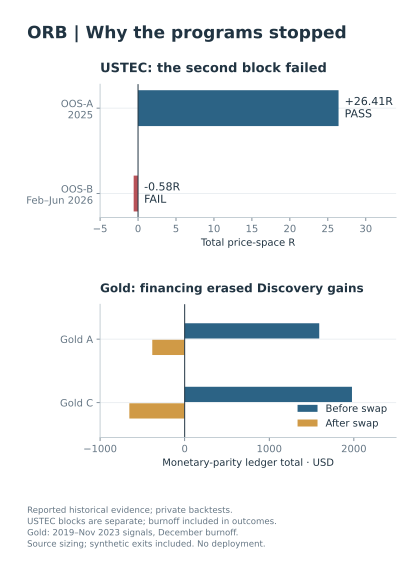
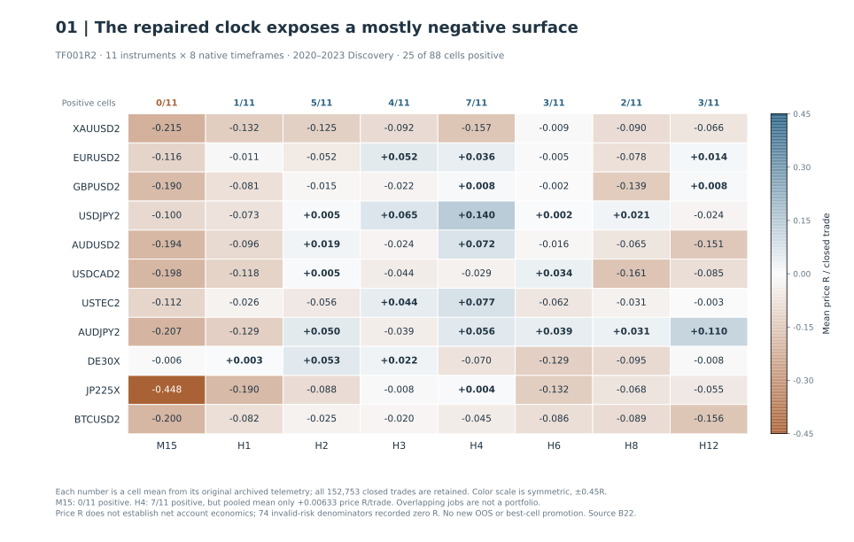
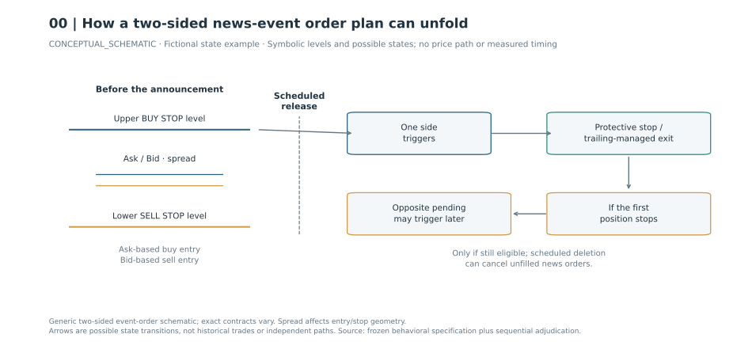

# TradingBotHQ: systematic trading research

I investigate whether familiar trading setups survive explicit rules, controls and trading costs. These four research programs include failed validation, unresolved mechanisms and a strategy shelved because live execution was too costly.

I direct the project's questions and priorities. Implementation, analysis and writing use AI assistance; the [contribution record](docs/ownership.md) separates documented decisions from unverified personal code authorship. The trading patterns have prior sources, retained in the private provenance records.

## Research highlights

### Opening Range Breakout (ORB)

Does an opening-range boundary add information beyond time-of-day momentum? Timing searches, placebo ranges and separate validation blocks found conflicting support: a promising Nasdaq validation was followed by an independent failure. The separate gold lineage passed implementation checks but failed economic qualification. The tested program closed for deployment; unopened successors remain unadjudicated. [Study and results](studies/opening-range.md) · [Other ORB branches](studies/opening-range-atlas.md)

Inspect the complete USTEC and gold searches, frozen robustness flags, paired placebo comparisons and financing ledger. [Figure sources and limits](docs/orb-visual-evidence.md).

### Engulfing Bar Play (EBP)

Can an engulfing candle support a continuation trade entered on a retracement? A persistent-order interpretation produced only three closed trades; replacement-policy arms produced 1,257 and 1,297. The repaired timeframe study was generally weak. No interpretation was selected as a winner; the separate small-candle association left reverse-trading economics untested. [Study and results](studies/engulfing-and-support.md)

Compare the configuration distribution, order-policy exposure and small-candle observation. A fictional lifecycle shows how an unfilled order can block later signals. [Figure evidence and limits](docs/ebp-visual-evidence.md).

### ORBINDEX: when a promising discovery failed its later test

I searched **3,456** DE30/JP225/UK100 opening-range configurations across the 24-hour clock, then compared three frozen DE30 portfolios in a shared-order simulation. Discovery looked promising, but **all three lost fixed-lot EUR in the 2024–July 2026 historical OOS scenario before extra commission**. Quote-path forensics helped examine why the result weakened; no portfolio was promoted. [Read the ORBINDEX study](studies/orbindex.md).

### MacroImpulse: news-driven event trading

MacroImpulse was shelved because live execution across brokers produced wide fills, large spreads and slippage. The available execution conditions were insufficient for the strategy. Historical filter studies and a separate medium-impact calendar defect retain their own findings. [Study and results](studies/news-research.md) · [Calendar forensic case](studies/data-forensics.md)

The schematic illustrates order mechanics. The article keeps the live execution decision separate from historical filter tests and calendar qualification. [Figure evidence and blockers](docs/macro-visual-evidence.md).

The [NOWICK research](studies/nowick.md) remains available as a historical, non-featured archive. Its negative findings and original authorship limitations have not been deleted.

## Research workflow

Hypothesis → Rules → Implementation → Controls → Validation → Decision

Before testing a chart idea, specify its signal, order lifetime, stop, target and costs. Then challenge the proposed mechanism: ORB uses placebo boundaries; ORBINDEX adds clock-surface robustness, synchronized order ownership and a spent later-period test. The archived NOWICK work uses matched ordinary candles. Discovery and validation retain separate roles, and a failed frozen gate remains a reason to stop. [Empirical methods](docs/empirical-methods.md)

## Technical implementation

The private research uses Python and MQL5/MT5 for event collection, trade replay and implementation comparisons. Statistical work includes cluster bootstrap intervals and matched controls, with spread, commission and financing distinguished in economic interpretation.

Public Python modules expose [accounting](src/srl/accounting.py), [semantic comparisons](src/srl/validation.py), [resampling](src/srl/resampling.py) and [evidence checks](src/srl/evidence.py). Automated tests and GitHub Actions check these methods, source-linked claims and deterministic outputs. They reproduce selected aggregate presentations and a separate synthetic methods example.

## Limitations and reproducibility

Historical findings rely on retained private reports; the public repository cannot replay the strategies without their original data and implementations. Setup illustrations and tested contracts have different scopes. Matching does not establish causality, and engineering parity does not establish live profitability. See the [evidence register](docs/evidence.md), [limitations](docs/limitations.md), [provenance](docs/provenance.md) and [reproduction instructions](docs/security.md#reproduce-the-checks).

## Explore the repository

- [Research atlas](docs/research-atlas.md): experiments, sample roles and decisions.
- [ORBINDEX public aggregates](data/orbindex-public.json) and [six reproducible study figures](scripts/render_orbindex.py): inspect the search, portfolio and OOS evidence.
- [Historical aggregates](results/historical-tables.md) and [figure source](scripts/render_historical.py): inspect the retained ORB and archived NOWICK summaries.
- [Source code](src/srl), [tests](tests) and [verification command](scripts/reproduce.py): inspect and reproduce the public methods.
- [Research engineering](studies/research-engineering.md): evidence manifests and implementation checks.

- [Remediation review](docs/reviews/visual-v002-remediation-2026-11-11.md): final checks and remaining publication limits.
