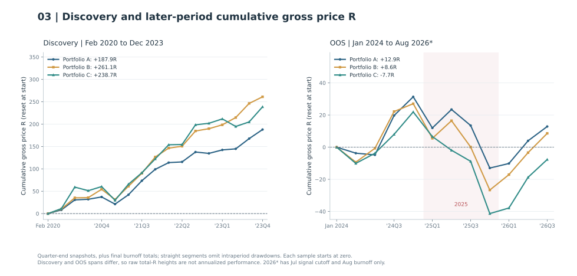

# TradingBotHQ: systematic trading research

I investigate whether familiar trading setups contain information that survives explicit rules, sensible controls and trading costs. This portfolio follows four research programs from chart intuition to empirical decisions, including failed validation and a backtest whose event calendar could no longer support its conclusion.

I direct the project's questions and priorities. Implementation, analysis and writing use AI assistance; the [contribution record](docs/ownership.md) separates documented decisions from unverified personal code authorship. The trading patterns have prior sources, retained in the private provenance records.

## Research highlights

### Opening Range Breakout (ORB)

An opening-session range offers a natural boundary for a continuation trade. Does that boundary add information beyond time-of-day momentum? Timing searches, placebo ranges and separate validation blocks found conflicting support: a promising Nasdaq validation was followed by an independent failure. The gold lineage passed implementation checks but failed economic qualification. The tested program closed for deployment; unopened successors remain unadjudicated. [Study and results](studies/opening-range.md) · [Other ORB branches](studies/opening-range-atlas.md)

### Engulfing Bar Play (EBP)

A candle that engulfs its predecessor suggests a directional move, entered on a retracement. Can that idea survive explicit order rules? A persistent-order interpretation produced only three closed trades; replacement-policy arms produced 1,257 and 1,297. The repaired timeframe study was generally weak. No interpretation was selected as a winner; the separate small-candle association left reverse-trading economics untested. [Study and results](studies/engulfing-and-support.md)

### ORBINDEX: when a promising discovery failed its later test

Could a precise index opening-range breakout survive a 24-hour timing search and a shared-order backtest? I evaluated **3,456** DE30/JP225/UK100 configurations, froze three synchronized DE30 portfolios, and compared their discovery and later-period results. **All three lost fixed-lot EUR on the 2024–July 2026 historical OOS scenario even before extra commission.** The negative result, code/parity checks, and post-OOS quote forensics are the study, not a trading system to deploy. [Read the ORBINDEX study](studies/orbindex.md).

### MacroImpulse: news-driven event trading

Scheduled economic releases can generate sharp price impulses, wider spreads and difficult fills. Execution comparisons and filter studies asked whether the full trade process could benefit. Several plausible filters failed; later calendar forensics found missing medium-impact coverage, invalidating a clean strategy verdict. The program remains shelved pending a qualified event universe and execution economics. [Study and results](studies/news-research.md) · [Calendar forensic case](studies/data-forensics.md)

The [NOWICK research](studies/nowick.md) remains available as a historical, non-featured archive. Its negative findings and original authorship limitations have not been deleted.

## Research workflow

Hypothesis → Rules → Implementation → Controls → Validation → Decision

A chart idea needs an observable signal, order lifetime, stop, target and cost model before it can be tested. Comparisons then challenge the proposed mechanism: ORB uses placebo boundaries; ORBINDEX adds clock-surface robustness, synchronized order ownership and a spent later-period test. The archived NOWICK work uses matched ordinary candles. Discovery and validation retain separate roles, and a failed frozen gate remains a reason to stop. [Empirical methods](docs/empirical-methods.md)

## Technical implementation

The private research uses Python and MQL5/MT5 for event collection, trade replay and implementation comparisons. Statistical work includes cluster bootstrap intervals and matched controls, with spread, commission and financing distinguished in economic interpretation.

Public Python modules expose [accounting](src/srl/accounting.py), [semantic comparisons](src/srl/validation.py), [resampling](src/srl/resampling.py) and [evidence checks](src/srl/evidence.py). Automated tests and GitHub Actions check these methods, source-linked claims and deterministic outputs. They reproduce selected aggregate presentations and a separate synthetic methods example.

## Limitations and reproducibility

Historical findings rely on retained private reports; the public repository cannot replay the strategies without their original data and implementations. Setup illustrations and tested contracts have different scopes. Matching does not establish causality, and engineering parity does not establish live profitability. See the [evidence register](docs/evidence.md), [limitations](docs/limitations.md), [provenance](docs/provenance.md) and [reproduction instructions](docs/security.md#reproduce-the-checks).

## Explore the repository

- [Research atlas](docs/research-atlas.md): experiments, sample roles and decisions.
- [ORBINDEX public aggregates](data/orbindex-public.json) and [six reproducible study figures](scripts/render_orbindex.py): inspect the search, portfolio and OOS evidence.
- [Historical aggregates](results/historical-tables.md) and [figure source](scripts/render_historical.py): inspect the retained ORB and archived NOWICK summaries.
- [Source code](src/srl), [tests](tests) and [verification command](scripts/reproduce.py): inspect and reproduce the public methods.
- [Research engineering](studies/research-engineering.md): evidence manifests and implementation checks.
