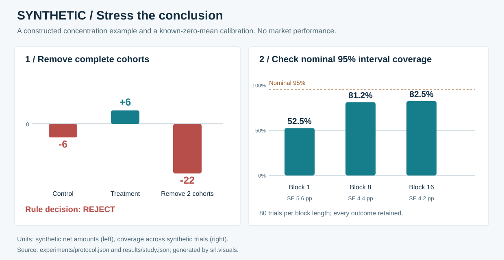

# Systematic Research Lab

**Original synthetic experiments in robustness, dependent-data inference and research correctness.**

This portfolio asks two concrete questions: does a positive aggregate survive removal of its strongest complete cohorts, and does a bootstrap interval cover a known mean when observations are dependent?

The [worked study](docs/study.md) keeps the uncomfortable answers. Its constructed positive total fails concentration stress. Its known-zero-mean simulation exposes undercoverage in every declared bootstrap setting. Neither result is historical trading performance.



## Reproduce the whole study

With Python 3.12 or later, from the repository root:

```sh
python scripts/reproduce.py --check
```

The command runs all tests, audits the public file inventory and local links, and recomputes the checked-in JSON and SVG. It needs only the standard library. To save a new result bundle with source/output hashes:

```sh
python scripts/reproduce.py --check --output build/my-run
```

An optional package installation is `python -m pip install -e .`. CI checks Python 3.12 and 3.13 on Linux and Windows.

## What to inspect

| Research question | Evidence and implementation |
| --- | --- |
| What carries the aggregate? | [Complete-cohort stress and the preserved rejection](docs/study.md#concentration-is-a-decision-gate); [cost-explicit accounting](src/srl/accounting.py). |
| How much uncertainty survives dependence? | [Known-DGP calibration](docs/study.md#calibrate-the-inference-tool); [paired circular blocks](src/srl/resampling.py). |
| Did the comparison change the events? | [Finite semantic parity and narrow tolerances](src/srl/validation.py), with [adversarial tests](tests/test_validation.py). |
| Can another researcher reconstruct the decision? | [Exact protocol](experiments/protocol.json), [all simulation trials](results/study.json), [replay and tamper tests](tests/test_reproduction.py). |

For a five-minute technical review, read the [study](docs/study.md), [method assumptions](docs/methods.md) and tests beside each small module.

## Interpretation and authorship

Every numerical result is a **synthetic demonstration**. The constructed payoff example is a teaching counterexample; the calibration evaluates a specified artificial data generator. There is no estimated market edge, broker execution, proprietary strategy or claim of future profitability. The [limitations](docs/limitations.md) explain the remaining inference and engineering boundaries.

This release was independently authored with AI-assisted engineering. All source, fixtures, prose and figures are original release material under [MIT](LICENSE). [Provenance and replay identities](docs/provenance.md) make the scope explicit.
