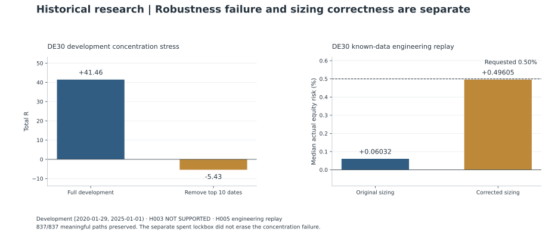

# MOMCONT on DE30X H1: Signal Persistence, Concentration Failure and a Risk-Sizing Repair

[Portfolio](../README.md) · [Evidence register](../docs/evidence.md) · [Published aggregates](../results/historical-tables.md)

This is **MOMCONT**, the momentum-continuation bot family, adapted to the **DE30X German equity-index CFD on H1 bars**. DE30 names the instrument sleeve, rather than a separate bot. The study produced three distinct findings: a development mechanism passed its initial test, a concentration stress rejected its robustness, and a later implementation audit found substantial under-risking. A subsequent positive sample could not rewrite the failed gate, and a successful engineering repair could not create new evidence of alpha. [D1](../docs/evidence.md#d1) [D7](../docs/evidence.md#d7)

| Research contract | Identity and decision |
| --- | --- |
| Hypothesis and comparison | The frozen MOMCONT signal must still satisfy its full conditions one bar later; compare that persistence treatment with the original signal control. |
| Samples | Development: 2020-01-29–2025-01-01; separate, subsequently authorized terminal test: 2025-01-01–2026-09-01. Ends are exclusive; both are now historical and spent. |
| Decision | Initial development support; concentration robustness **NOT SUPPORTED**; qualified terminal pass; sizing correction passed a separate historical engineering replay. |
| Contribution | Research governance, robustness adjudication and correctness review. Automated research/tester runs supplied the artifacts; exact historical hand-coding ownership is not established. [Ownership](../docs/ownership.md) |

The source contracts and chronology are retained in [D1–D9](../docs/evidence.md#d1).

Results below use net R, normalized to initial trade risk, with profit factor and drawdown measured in R-space. They are historical research aggregates, not account-return forecasts or claims about current deployment readiness.

## Initial development support was narrow

The development intervention required the frozen signal to persist for one additional bar. It was evaluated on **29 January 2020 to 1 January 2025, end exclusive**. The resulting path contained **837 trades, +41.4607R, profit factor 1.1412 and maximum R drawdown 20.0313R**. It passed the six initial development gates. [D1](../docs/evidence.md#d1)

The weaker 2020–2022 segment improved from **−2.279R** under the reference to **+3.3215R** under persistence. Yet the improvement was small, and the later 2023–2024 segment contributed **+38.1392R**. The five best entry dates still supplied **59.41%** of total net R. Development support therefore came with visible regime and concentration questions. [D1](../docs/evidence.md#d1)

Costs mattered. Gross development output was **+74.9014R**, while swap contributed **−33.4407R**, leaving the reported **+41.4607R** net. A normalized gross result would have concealed a large part of the economic burden. [D1](../docs/evidence.md#d1)

## Concentration overturned the robustness case

The next experiment applied preregistered robustness stresses to the frozen development result. Removing the **ten most profitable complete entry-date cohorts** removed **+46.8901R**, leaving **−5.4293R**, profit factor **0.9815** and drawdown **24.2790R**. The declared rule treated a non-positive result under that stress as a failure. The final verdict was **NOT SUPPORTED**. [D2](../docs/evidence.md#d2)

Other tests were more favorable: leave-one-year-out exclusions remained positive, removing the five best individual trades left a positive total, and larger swap charges did not erase the aggregate. A calendar-month block bootstrap also met its own gate. None of these results overruled the concentration failure. The project had defined a conjunction of requirements, not a vote among whichever diagnostics looked strongest. [D2](../docs/evidence.md#d2)

## A terminal test was authorized after the failure

The program subsequently made an explicit decision to evaluate the unchanged candidate on a separate terminal period, **1 January 2025 to 1 September 2026, end exclusive**. This was a later decision in the research chronology; the earlier development robustness rejection remained on record. It was not retrospectively reclassified as support. [D3](../docs/evidence.md#d3)

The completed terminal result contained **300 trades, +21.0171R, profit factor 1.2096 and maximum R drawdown 15.0985R**. It passed its six recorded precommitted gates. Removing the best trade left **+16.8873R**; removing the three best entry-date cohorts left **+9.8748R**. [D4](../docs/evidence.md#d4)

Concentration remained material. The top three dates accounted for **53%** of total R and the top five for **85%**. Removing the ten best dates made this sample negative too. Moreover, **2025 contributed +19.0691R**, while **2026 through August contributed +1.9480R**. These limits belong beside the pass, rather than hidden behind a combined equity curve. [D4](../docs/evidence.md#d4)

The period is now spent and cannot be presented as unseen validation again. The completed-run record reports no period-boundary leakage, but the present review does **not** independently reconstruct the complete access history or establish that every pre-attempt access gate was verified. The strongest defensible statement is the recorded terminal result and its retrospective boundary check, with the access-history qualification retained. [D5](../docs/evidence.md#d5)

## The implementation risk was different from the requested risk

A separate audit exposed an implementation defect. The original sizing calculation used tick-value metadata inconsistently with the actual loss calculation. A **0.5% equity-risk request** produced median actual initial risk of roughly **0.0603%** in development and **0.0919%** in the terminal sample. The same requested percentage did not represent the intended exposure. [D6](../docs/evidence.md#d6)

The correction used loss-per-lot accounting consistent with the platform’s profit-and-loss mechanics. Its validation replay was restricted to known development data. The engineering question was whether exposure could be corrected while preserving the established signal and trade path. [D7](../docs/evidence.md#d7)

After repair, median actual initial risk was **0.49605%** for the **0.5%** request; the fifth percentile was **0.48763%** and the maximum **0.50004%**. All **837 meaningful trade paths** were preserved, alongside exact signal-semantic parity across **27,622 rows**. This was evidence of sizing correctness for the tested contract, not another out-of-sample economic test. [D7](../docs/evidence.md#d7)

The certificate belongs to that historical build and contract. The primary record subsequently documents an October 2026 production risk-input hotfix. The earlier path-preservation result therefore cannot certify the current production build or authorize deployment. [D7](../docs/evidence.md#d7)

## Exact hashes needed a transparent amendment

The original exact path hashes disagreed. Read-only diagnosis found matching meaningful fields but redundant actual entry and exit price strings differing by approximately **3.64 × 10⁻¹²**. The audit transparently amended the rule to permit an absolute tolerance of **10⁻⁹** for those two fields only; semantic path fields remained exact. No economic rerun was used to obtain the pass. [D8](../docs/evidence.md#d8)

The amendment is a limitation to disclose, not a reason to suppress the engineering result. An exact text hash answers a different question from equality under an explicitly justified numerical contract.

## Later portfolio work did not erase these distinctions

A later, separately specified portfolio-inclusion experiment used the common **2025-01-01 to 2026-08-01** window. It rejected adding DE30 to the evaluation architecture. Funded-account simulations supported inclusion only within the limited tested low-risk region, including block-length sensitivities and an expectancy haircut. Those findings were conditional on the historical paths and account model; they were not current operational approval. [D9](../docs/evidence.md#d9)

The resulting evidence remains layered: initial development support, a preserved robustness rejection, a qualified terminal pass, a spent evidence period, a separate sizing repair, and bounded portfolio simulations. Each answers a different question. None turns concentration, access-history uncertainty or implementation parity into a general claim of future profitability.
