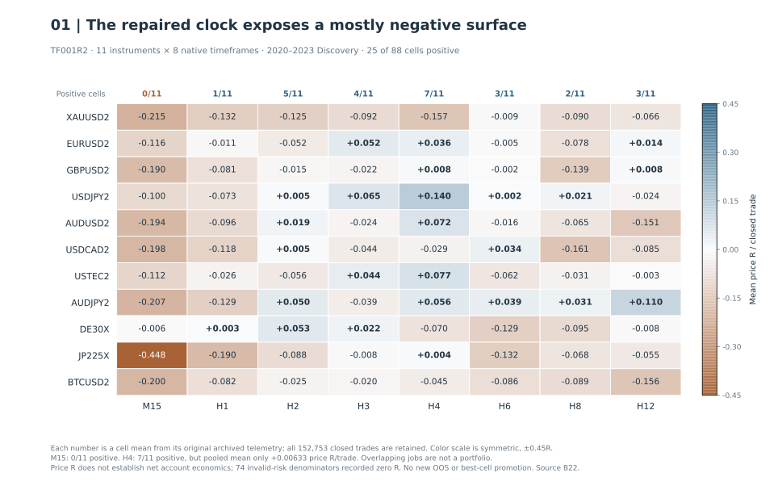
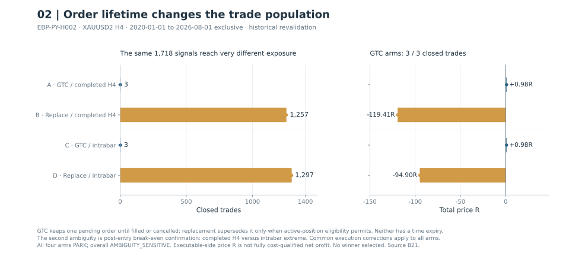
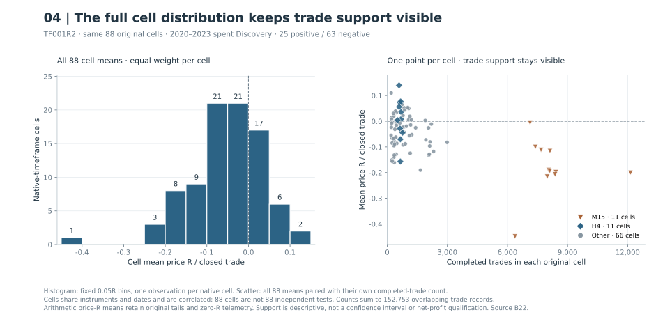

# Engulfing Bar Play: when order rules change the experiment

[Portfolio](../README.md) · [Research atlas](../docs/research-atlas.md) · [Evidence register](../docs/evidence.md)

Does an engulfing candle identify continuation that survives an executable retracement order? The setup waits for a pullback into the engulfing candle, while the pending order's lifetime determines which later signals can trade.

The repaired native-clock matrix is mostly negative: **25 of 88 cells** are positive on already-examined 2020–2023 Discovery. All eleven M15 cells are negative; H4 has seven positive cells but a pooled mean of only **+0.00633 price R per trade**. The matrix was closed as Discovery, with no broad transportable edge and no replacement of frozen candidates.

*The native clock repair changes the scientific identity of the comparison. Each annotated mean comes from an original archived cell, with 152,753 closed trades in total; overlapping jobs do not form a tradable portfolio. Price R is not cost-qualified account profit. [Full-resolution SVG](../figures/ebp-native-timeframe.svg) · [Source binding B22 and limits](../docs/ebp-visual-evidence.md#original-byte-custody) · [All 88 disclosed aggregate rows](../data/ebp-public.json).*

Order rules create a second problem: a long-lived retracement order can stop later signals becoming trades. A separate four-contract Python comparison changes pending-order lifetime and break-even timing. The small-candle observation is a third experiment, testing an association on spent history. These results retain their separate definitions and decisions.

## From engulfing candle to retracement order

An engulfing bar can sweep the previous candle's high or low and close beyond the opposite side of the previous candle's body. The two candles need not have opposite colors. This is typically framed as a higher-timeframe swing setup, with a focus on four-hour charts and above.

In one explicit ruleset, a close within roughly **15%** of the engulfing candle's extreme is treated as a stronger setup, with a limit entry at **25% retracement**, stop at **75% retracement** and **2R target**. A less decisive close uses entry at **50% retracement**, a stop at the retracement origin and the same **2R target**. Optional management rules include breakeven after a fresh high or low, limiting simultaneous trades per instrument and evaluating indecisive candles in context.

Each tested contract specifies which of these mechanics it implements. The results below distinguish historical replays, a repaired Discovery surface and an observational mechanism test. [Evidence and reproducibility limits](../docs/provenance.md) apply throughout.

## Pending-order lifetime changed which signals could trade [B21](../docs/evidence.md#b21)

*EBP-PY-H002, XAUUSD2 H4, 2020-01-01 to 2026-08-01 exclusive: historical revalidation. Each arm sees 1,718 signals; order ownership changes exposure. All arms PARK and the overall verdict is AMBIGUITY_SENSITIVE. The positive three-trade arms fail exposure/stability gates. [Full-resolution SVG](../figures/ebp-order-policy.svg) · [Exact policies, execution corrections and source binding B21](../docs/ebp-visual-evidence.md#original-byte-custody).*

Corrected-source EBP revalidation exposed a negative original Gold result: **1,039 closed trades**, **-102.5982R**, and profit factor **0.8373** over its already-inspected historical window. Separately, a source-faithful Python interpretation produced only three closed trades because one long-lived pending order blocked later setups. Its positive **+1R** aggregate failed exposure and stability gates and was parked. A good-till-cancelled (GTC) order can occupy the entry slot while later signals pass; replacing it changes which opportunities reach the market.

*SCHEMATIC ONLY / CONCEPTUAL_SCHEMATIC. This invented order-state example illustrates the source-defined H002 pending policies. Replacement is shown only when active-position eligibility permits: a live position without applied break-even blocks it. Both policies have no time expiry. A/B/C are fictional labels and neither row describes a historical trade path or a contemporaneous counterfactual sequence; H002 arms were separate engine contracts. [Full-resolution SVG](../figures/ebp-pending-lifecycle.svg) · [Source binding B21 and schematic status](../docs/ebp-visual-evidence.md).*

A frozen ambiguity matrix made that dependency visible. Two replacement-policy arms produced **1,257** and **1,297** trades, with totals **-119.4104R** and **-94.9029R**, while the GTC arms remained sparse. No interpretation was selected as a winner. These are different contracts and cannot be pooled as repeated confirmation of one strategy. Order lifetime and occupancy belong in the strategy specification before outcomes are interpreted.

## Repairing the signal clock before comparing timeframes [B22](../docs/evidence.md#b22)

The original timeframe matrix had a configuration defect: non-H4 chart periods still used an H4 signal clock. The repaired TF001R2 study verified **88 of 88 native-timeframe cells**, spanning eleven instruments and **152,753 closed trades** in 2020 to 2023. Only **25 cells** were positive; all eleven M15 cells were negative. Even the H4 pooled mean was approximately **+0.00633 price-R** per trade.

*Each histogram observation is one native-timeframe cell, with fixed 0.05R bins. The scatter pairs all 88 exact cell means with their own trade counts, which range from 193 to 12,143. Shared dates and instruments make the cells correlated; their trade records overlap. Neither the histogram nor the scatter is a confidence interval, independent test count or investable portfolio. [Full-resolution SVG](../figures/ebp-cell-distribution.svg) · [Source binding B22 and derivation](../docs/ebp-visual-evidence.md#original-byte-custody).*

This is a Discovery topology map, not a best-cell competition or fresh OOS. Previously frozen candidates remained unchanged. Their separate validation records were mixed: a GBPUSD survivor retained qualification work, a USDJPY lockbox was weak, and a Nasdaq H4 candidate failed validation. After-cost significance and execution qualification remained separate gates. The repaired matrix did not authorize selecting a new clock or replacing an already-tested candidate after seeing the surface.

## The small-candle association left reversal untested [B23](../docs/evidence.md#b23)

*STAT001 compares filled outcomes after ranking all placed opportunities by engulf range / causal ATR within symbol-year. Only the registered equal-stratum aggregate has a reported post-selection exploratory confidence interval, which is not selection-adjusted; the figure shows no invented subgroup intervals. Retrospective observation does not establish a beneficial stop change or profitable opposite-direction execution. [Full-resolution SVG](../figures/ebp-small-candle.svg) · [Frozen estimator, 20,000 month-block replicates and source binding B23](../docs/ebp-visual-evidence.md#original-byte-custody).*

STAT001 froze an observational small-candle mechanism test on three qualified M15 instrument histories from 2020 to 2023. The extraction record contained **28,097 placed opportunities** and **21,917 fills**. The equal-weighted contrast across twelve instrument-year strata was **-0.271784 price-R** for the smaller-versus-larger relative-range quartiles, with a **post-selection exploratory 95% interval [-0.330415,-0.212793]** from 20,000 month-block bootstrap replicates; nine strata were negative. The interval is **not selection-adjusted**: freezing the bootstrap after strategy/domain selection on spent Discovery does not make it an independent confirmation.

The association was heterogeneous: two instruments drove it while the third was approximately null. Gold was excluded because the exact at-test history identity was unresolved. The frozen negative-association finding was retained, while the parent Anti-EBP program was administratively **PARKED**. No causal stop intervention or reversed executable-economic test followed. An observed disadvantage in the original setup does not establish why it occurred or imply profitable opposite-direction trading.

## Quotes alone could not reconstruct broker acceptance [B24](../docs/evidence.md#b24)

EBP tooling separated reconstructed signal geometry from historical order acceptance. One replay reached a recorded market-closed rejection even though raw quotes existed, followed by acceptance on retry. The quote stream alone could not establish the missing historical session rules or broker constraints. Archived event-tape diagnostics were labeled oracle-assisted; independent causal broker parity remained **INDETERMINATE**.

A separate three-market transportability matrix left all twelve economic executions unrun because a qualified source and historical clock contract were missing, despite recorded engine tests and regression replay. Schedule-loader canaries likewise distinguish schedule consumption and observability from placebo significance. The tooling establishes these engineering limits while leaving the economic tests unrun. Historical session and broker constraints still need independent evidence.

The [visual evidence note](../docs/ebp-visual-evidence.md) binds every figure to original archived bytes, discloses missing broker/cost and subgroup-uncertainty evidence, and gives the public figure-rebuild command. The public bundle reproduces aggregate charts; the private archive remains the authority for the historical market studies.
