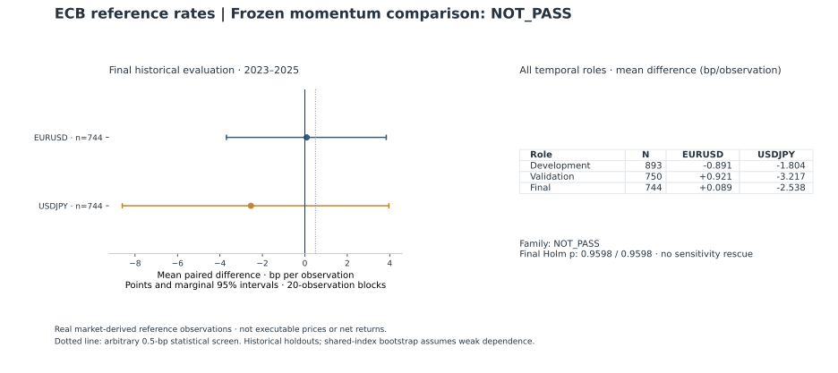

# ECB daily FX: a frozen momentum comparison that did not pass

[Portfolio](../README.md) · Source record: [FX1](../docs/evidence.md#fx1) · [Complete results](../results/fx-tables.md)

**Decision: `NOT_PASS`.** A fixed twenty-observation momentum rule failed its
precommitted joint comparison with an unconditional always-long reference-rate
benchmark. EURUSD's final-period difference was small and inconclusive; USDJPY's
estimate was negative. Both marginal confidence intervals included zero.

This is an end-to-end publicly reproducible study of **real market-derived
reference observations**, with a frozen source snapshot, causal time indexing,
dependence-aware inference and a preserved negative decision. It does not
establish executable trading profitability.



## The question and what was frozen

Does the sign of the preceding twenty daily reference observations improve on
an always-long reference-direction benchmark? The two preselected instruments
were EURUSD and USDJPY, the latter calculated as JPY-per-EUR divided by
USD-per-EUR. Shared source inputs mean these are not independent replications.

For observation index t, the signal was `sign(log(P[t]/P[t-20]))`. The measured
change was `log(P[t+2]/P[t+1])`: it begins one observation after the signal's
last input. The paired statistic is signal-signed change minus always-long
change on the identical target. Twenty observations is not twenty calendar
days. Temporal ordering prevents direct future-input leakage; it does not
identify a causal market mechanism.

The [exact preaccess protocol commit](https://github.com/vda93/systematic-research-lab/blob/3dd50f4bfe5299e345acf3fe0e2b8c697967fe2e/experiments/ecb-fx-mom20-protocol.md)
is `3dd50f4bfe5299e345acf3fe0e2b8c697967fe2e`. The
[acquisition receipt](../data/ecb-acquisition.json) records retrieval on
21 October 2026 at 04:42:04 UTC, that protocol commit and the exact method-file
hashes. It records 2,455 selected rows and a single-CSV archive passing the
notice and integrity checks. The [selected CSV](../data/ecb-fx-reference.csv)
SHA256 is `b6aa4be6327be74aab465f95ad1db8e97636fb215b9208b35d1b1744f10815b7`.

An initial run used NumPy 2.5.4. Before result publication it was rerun with the
unchanged frozen methods and pinned NumPy 2.5.1. All rounded statistics and the
verdict were identical. The [execution correction receipt](../data/ecb-execution.json)
retains both result identities; the original artifact remains preserved outside
Git. This was an environment correction, with no rule or sample change.

The analysis starts in July 2016 because the [ECB documented a publication-time
change effective 1 July 2016](https://www.ecb.europa.eu/press/pr/date/2015/html/pr151207.en.html).
June is development-feature warmup. Development ends in 2019, validation covers
2020 to 2022, and final historical evaluation covers 2023 to 2025. Signals and targets
crossing validation/final role boundaries are purged, including the feature
lookback. The exact eligible target dates appear in the complete tables.

These are historical temporal holdouts designed in October 2026, **not fresh
prospective OOS**. Provider-metadata searches incidentally displayed numeric
examples before June 2016 and during 2026, outside the selected window. This
study does not claim investigators had never encountered FX history before.

## Primary result

All values below are basis points of signed logarithmic reference-rate change
per observation. They are not net returns.

| Final historical evaluation | EURUSD | USDJPY |
| --- | ---: | ---: |
| Paired targets | 744 | 744 |
| Mean signal statistic | +1.18133 | −0.07116 |
| Mean always-long benchmark | +1.09215 | +2.46634 |
| Mean paired difference | **+0.08918** | **−2.53750** |
| Marginal 95% interval | [−3.69317, +3.83619] | [−8.60250, +3.96191] |
| Raw one-sided p-value | 0.4799 | 0.7840 |
| Holm-adjusted p-value | 0.9598 | 0.9598 |
| Frozen asset decision | `INCONCLUSIVE` | `NEGATIVE_COMPARISON` |

An asset could pass only with a strictly positive primary interval lower bound,
Holm-adjusted p-value at most 0.05 and mean difference at least **0.5 bp**. Both
assets had to pass for family PASS. The 0.5-bp minimum was an **arbitrary
precommitted statistical relevance screen**, not a validated economic hurdle.
EURUSD failed all three screens; USDJPY also failed all three. A failed
positive-effect test is not proof of zero effect, and USDJPY's negative estimate
does not establish statistically reliable negative predictability.

The primary method used 9,999 circular moving-block draws of length 20,
with identical sampled date indices across both assets. One-sided null draws
centered each paired-difference series. Holm controlled the two final primary
tests. The displayed intervals are marginal, not simultaneous. Block resampling
requires sufficiently weak dependence and approximate stability; its circular
join, structural regimes and finite sample can undermine nominal coverage.

The [independently written check](../tests/test_fx_figure.py) reconstructed the final paired differences from
the CSV and recomputed all primary draws using explicit gathered indices rather
than the implementation's prefix sums. It matched N, mean differences, interval
endpoints and raw p-values. That is an implementation consistency check on one
snapshot, not independent provider verification or economic validation.

## Temporal variation and fixed challenges

| Role | Paired targets | EURUSD mean difference | USDJPY mean difference | Equal-weight pooled mean |
| --- | ---: | ---: | ---: | ---: |
| Development, July 2016 to 2019 | 893 | −0.89131 | −1.80351 | −1.34741 |
| Validation, 2020 to 2022 | 750 | +0.92137 | −3.21713 | −1.14788 |
| Final historical, 2023 to 2025 | 744 | +0.08918 | −2.53750 | −1.22416 |

All support minima passed. The pooled figures and earlier roles are descriptive,
not additional confirmatory tests. The complete [generated tables](../results/fx-tables.md)
retain every role, asset, block length, annual contribution, sign count,
always-short/flat comparator and sensitivity.

The final medians were zero for both assets. On long-signal observations the
signal statistic exactly equals the always-long benchmark, creating structural
zero differences. There were 402 long EURUSD signals and 473 long USDJPY signals;
unchanged EURUSD targets contributed three further zeros. This is not evidence
of missing observations or a reason to remove the zeros.

The fixed 10- and 60-observation block sensitivities retained intervals spanning
zero for both final assets. An additional observation of delay produced a
descriptive EURUSD difference of +2.36981 bp and USDJPY difference of −2.73528 bp.
This was a predefined sensitivity, without a new confirmatory test or permission
to replace the primary target. Its positive EURUSD value does not rescue the
frozen failed comparison.

Removing 2024, the strongest positive final calendar-year pooled contribution,
changed the pooled difference from −1.22416 to −2.04700 bp over 488 retained
targets. This removal is an outcome-dependent concentration diagnostic with
no inferential p-value. Annual contributions and the corresponding development
and validation removals remain visible in the complete tables.

## Data engineering, rights and reproduction

The official [ECB historical download](https://www.ecb.europa.eu/stats/eurofxref/eurofxref-hist.zip)
was acquired without a key after the protocol freeze. Selection preserved the
source USD/JPY decimal strings. The acquired snapshot passed qualification.
The checks reject duplicate/noncanonical dates, nonpositive or nonfinite values,
unexpected weekend rows, excessive calendar gaps and incompatible archive
structure. No interpolation, forward
fill, outlier removal or parameter fitting was used. The seven-day gap screen
does not certify a complete historical TARGET calendar.

ECB reuse conditions support accurately reproduced, attributed data and
explicitly identified modifications; see [DATA_LICENSE.md](../DATA_LICENSE.md).
The data are not relicensed under the repository's software license. USDJPY,
logarithmic changes and study statistics are author calculations. No ECB
endorsement is implied. The frozen snapshot supports exact default reproduction
despite a mutable upstream URL.

From a clean clone, install the pinned project and replay offline:

```bash
python -m pip install -r requirements-lock.txt
python -m pip install --no-build-isolation --no-deps .
python scripts/fx_study.py --check
python scripts/render_fx.py
```

The first check recomputes the result JSON from the included CSV; the second
checks the figure and complete table bytes. The raw acquisition archive remains
outside Git; its hash, selected-file identity and prior protocol commit are
public in the receipt. A future retrieval creates a different vintage and
cannot overwrite this study silently.

The [ECB framework](https://www.ecb.europa.eu/stats/pdf/exchange/Frameworkfortheeuroforeignexchangereferencerates.en.pdf)
states these are information reference rates. A retrieved historical series can
include revisions; exact past publication latency was not verified. Neither a
delayed signal nor a reference-rate cross calculation establishes executable
fills. Spread, financing, carry, slippage, lot sizing and net profitability were
**`NOT_EVALUATED`**. This failed benchmark comparison is retained without
retuning, selecting a replacement delay or proposing live deployment.
