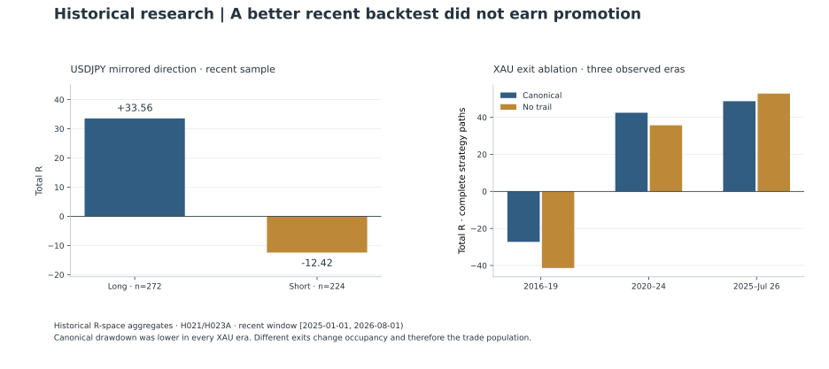

# Momentum continuation: why the attractive exit was not selected

[Portfolio](../README.md) · [Evidence register](../docs/evidence.md) · [Published aggregates](../results/historical-tables.md)

A research program can produce a stronger recent backtest and still leave its reference architecture unchanged. This study examined that decision in a frozen H1 momentum-continuation lineage: first by testing directional symmetry on USDJPY, then by challenging the XAU exit, and finally by comparing complete portfolio paths. The useful result was a sequence of rejected, qualified and indeterminate interventions.

The reported returns use R, a normalized unit of initial trade risk. Profit factor and maximum drawdown below are computed in R-space. They describe the historical research paths; they are not account-return percentages, live execution records or forecasts.

## A directional mirror failed its own test

The first intervention changed direction while keeping the reference mechanism frozen. A mechanically mirrored short rule was compared with the long-only control on USDJPY H1 over **1 January 2025 to 1 August 2026, end exclusive**. The long control had to reproduce the archived reference before treatment results could be assessed. [M1](../docs/evidence.md#m1) [M2](../docs/evidence.md#m2)

| Direction | Trades | Total net R | Profit factor | Maximum R drawdown |
| --- | ---: | ---: | ---: | ---: |
| Long-only control | 272 | +33.5558 | 1.4146 | 8.427 |
| Mechanically mirrored short | 224 | −12.4220 | 0.8559 | 26.359 |

The short arm failed the precommitted support rule. The decision rejected directional symmetry for this frozen mechanism and sample; it did not open a search for more favorable short thresholds. Nor does the comparison prove that the long arm has a stable all-period edge: its block-bootstrap 95% interval for mean R included zero. A mechanically mirrored rule is a useful falsification test, with conclusions limited to the intervention actually tested. [M2](../docs/evidence.md#m2)

## The no-trail result changed future opportunities

The exit experiment used the same recent window on USDJPY and XAU. Both trailing-enabled controls had to match the reference semantically and numerically before the trailing-disabled paths were unlocked. This made implementation drift a separate gate from the treatment result. [M1](../docs/evidence.md#m1)

On XAU, removing the trail raised total net R from **+48.7192R to +52.8310R**, while observed drawdown rose from **6.221R to 12.658R**. Trade count fell from **249 to 83**. Longer positions occupied the symbol and blocked **185 opportunities** present in the canonical path; the no-trail path also contained entries absent from that reference. The experiment changed the future entry set as well as the exits. [M3](../docs/evidence.md#m3)

A common-entry comparison helped isolate the exit effect, but it was small: **64 paired XAU entries**, with a mean no-trail-minus-canonical difference of **+0.40772R**. The preregistered block-100 confidence interval was **not estimable**, because the paired sample had fewer than 100 observations. All reported alternative sensitivity intervals crossed zero. USDJPY had only 81 paired entries and the same inferential limitation. These were directional observations, not statistically established paired improvements. [M3](../docs/evidence.md#m3)

## Earlier eras challenged the recent picture

The next stage examined XAU across three explicitly separated periods. The early and middle periods were retrospective historical diagnostics. The recent sample was reused from the prior experiment and was already observed; it was never renamed fresh out-of-sample evidence. [M4](../docs/evidence.md#m4)

| Era and dates, end exclusive | Canonical total R | No-trail total R | Canonical drawdown R | No-trail drawdown R |
| --- | ---: | ---: | ---: | ---: |
| Early: 2016-01-01 to 2020-01-01 | −27.2415 | −41.3705 | 49.192 | 66.558 |
| Middle: 2020-01-01 to 2025-01-01 | +42.4909 | +35.7006 | 22.791 | 30.581 |
| Recent: 2025-01-01 to 2026-08-01 | +48.7192 | +52.8310 | 6.221 | 12.658 |

No-trail retained its total-R advantage only in the recent era. The canonical exit had lower observed drawdown in all three. The early canonical result was itself negative, a direct limit on any claim of stable performance across eras. Higher average returns among the fewer no-trail trades did not settle the whole-path decision. [M4](../docs/evidence.md#m4)

## A frozen alternative earned further comparison

Descriptive path analysis preceded a small, frozen exit comparison. The candidate set was committed before its comparative outputs existed; it was not expanded until a retrospective winner appeared. Six archived control paths passed semantic and metric parity before the new treatments were assessed. [M5](../docs/evidence.md#m5)

A mechanical ratchet showed the most constructive new cross-era behavior. Its mean common-entry differences against canonical were **+0.0641R, +0.0956R and +0.2150R** in the early, middle and recent eras. Those conditional entry comparisons did not remove the cost of a changed strategy path. Recent ratchet total was **+47.8081R**, slightly below canonical **+48.7192R**, and its drawdown was **13.265R**, more than twice canonical **6.221R**. The early ratchet path also remained negative. [M6](../docs/evidence.md#m6)

That combination justified a bounded portfolio comparison, not immediate promotion of the exit. It preserved the distinction between a constructive trade-level diagnostic and a preferable complete architecture.

## The portfolio comparison reached a stopping point

The final experiment compared a USDJPY-plus-XAU canonical portfolio with the same USDJPY sleeve plus ratchet XAU. Only the common **2025-01-01 to 2026-08-01** window was admissible. The primary analysis used **20,000 paired calendar-block paths**, resampling the same source blocks for both architectures, with 28-day blocks primary and 14-day and 56-day sensitivities. Complete trade lifecycles were retained, boundary overlaps were counted, and unavailable alternative entries were not invented. [M7](../docs/evidence.md#m7)

Canonical met the precommitted evaluation decision at the primary block length; the 14-day comparison was indeterminate and the 56-day comparison again favored canonical. The funded comparison was ultimately **INDETERMINATE** because an apparent ratchet advantage at the longest block length did not survive sensitivity analysis. The architecture therefore retained canonical exits. [M7](../docs/evidence.md#m7)

These simulations used archived R and an H1 approximation to intraday equity stress. Their path frequencies depend on resampling and account-model assumptions; they are not forecasts or tick-exact broker certification. A synthetic demonstration can reproduce the generic comparison methods without reproducing these private historical observations.

The lineage then stopped exit and alpha tuning. Reopening it requires a new falsifiable question grounded in forward evidence or a correctness failure. That stopping rule is part of the result: the program preserved a tempting alternative and its limitations without turning continued experimentation into an obligation to select it. [M8](../docs/evidence.md#m8)
