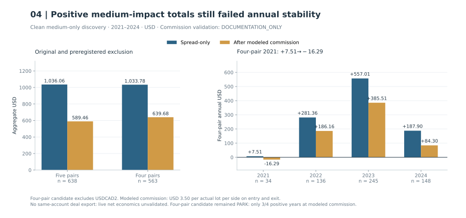
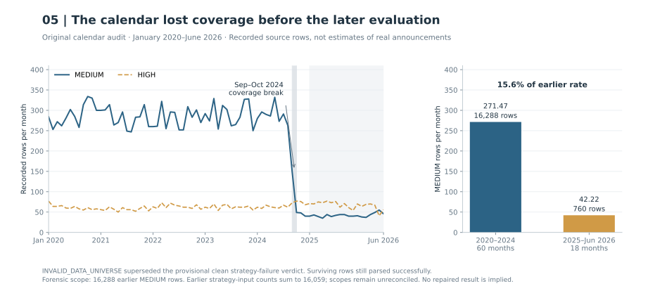

# MacroImpulse: why live execution stopped the strategy

[Portfolio](../README.md) · [Research atlas](../docs/research-atlas.md) · [Evidence register](../docs/evidence.md)

MacroImpulse was shelved because live execution across brokers produced wide fills, large spreads and slippage. The available execution conditions were insufficient for the strategy. This was the owner's practical reason for stopping the program. [Owner's closeout clarification](../docs/provenance.md#macroimpulse-closeout-clarification)

The historical studies below tested execution logic and proposed filters around preplanned news-event triggers. A separate medium-impact evaluation had a calendar-coverage defect; that limits what its backtest can establish.

## A positive baseline did not qualify the proposed interventions

The frozen high-impact bridge recorded **+$4,250.48 spread-only across 1,396 trades**, with all ten 2023–2024 pair-year cells positive. The separately frozen spread filter reduced P&L by **$7.62**, removing three profitable trades. Later medium-impact research remained positive in aggregate after documented commission, but its four-pair candidate failed annual stability: **2021 fell from +$7.51 to −$16.29**. Each result belongs to a separate experiment, sample and accounting scope.

Scheduled economic announcements can reprice currencies quickly. MacroImpulse studied entries at preplanned trigger levels around the release, seeking to capture the impulse. Wider spreads, slippage and fill uncertainty can consume the opportunity; price can also stop the first position and trigger the opposite side.

*CONCEPTUAL_SCHEMATIC — Fictional state example of a generic two-sided event-order plan; exact contracts vary. The frozen behavioral specification supplies the quote-side and order-lifecycle mechanics. Arrows show possible state transitions, not market prices, measured timing, fill probabilities or a trade recommendation.*

[Open full-resolution SVG](../figures/macro-mechanics.svg)

Several proposed filters failed their tests. These historical comparisons do not establish that live fills across brokers were acceptable. The separate [incomplete calendar](data-forensics.md) prevents a clean verdict on one medium-impact evaluation.

The figures reproduce already-opened historical aggregates; no backtest or new evaluation was run. The [public aggregate extract](../data/macro-public.json), [renderer](../scripts/render_macro.py) and [figure evidence review](../docs/macro-visual-evidence.md) identify original archive and member hashes, sample roles and missing evidence. [Evidence and reproducibility limits](../docs/provenance.md) apply throughout. Reported P&L is research-account USD; no account-equity curve or new uncertainty interval is reconstructed.

## Matching execution under controlled events [B08](../docs/evidence.md#b08)

The AI-assisted engineering program reconstructed an event-driven execution state machine and compared it with a vendor reference EA under controlled events, broker ticks and parameters. Recorded parity gates covered pending geometry, spread-aware stops, trigger/fill behavior, trailing ratchets, reverse-exit ordering, deletion, commission, and final balances on three FX instruments. Those controlled events establish neither full-year event-selection equivalence nor the vendor reference's standalone profitability.

A separate historical timestamp qualification found that the selected news source aligned directly with the qualified UTC clock, without a timestamp shift or DST adjustment. That frozen alignment is an input contract, not proof of publication latency. Behavior beyond the tested events, brokers and configurations remains unqualified, as does the vendor reference's broader performance.

## A positive bridge did not justify the spread filter [B09](../docs/evidence.md#b09)

The frozen high-impact baseline was evaluated on ten FX pair-year cells in 2023 to 2024. The recorded aggregate contained **1,396 trades**, spread-only P&L of **+$4,250.48**, and spread-only profit factor **3.6889**. All ten cells were positive. This is historical bridge evidence under its specified accounting, with commission excluded; it is not a net investable-return claim.

*2023–2024 high-impact bridge. The original cell summary reconciles to 1,396 trades and +$4,250.48; color starts at zero. This favorable control did not establish net live economics.*

[Open full-resolution SVG](../figures/macro-baseline.svg)

A separately frozen spread-filter validation then ran twenty pair-year-arm cells in 2021 to 2022. Integrity passed, but the treatment reduced spread-only P&L by **$7.62**. No pair or year improved. The filter removed only three completed trades, all profitable, and did not remove the targeted double-trigger losses. The filter was **REJECTED** without retuning. The positive baseline did not justify this filter.

*Separate 2021–2022 frozen validation. Absolute totals use a zero baseline; the second panel shows treatment minus control. The only three completed trades removed were winners. The decision remains REJECT without retuning.*

[Open full-resolution SVG](../figures/macro-spread-filter.svg)

## Opposite-side triggers sometimes recovered first-leg losses [B10](../docs/evidence.md#b10)

An early cross-broker interpretation treated two-sided triggering as a broadly toxic mechanism. Later Exness evidence required a narrower account. All **139** inspected double-trigger groups were sequential: the first position had already stopped before the opposite side triggered. First legs lost **$287.99** spread-only, while subsequent reversal legs recovered **$188.22**. Suppressing the second leg would therefore remove meaningful recovery.

*2021–2024 EventPath development, canonical adjudication as reported. The first leg had stopped before the opposite leg triggered. These dependent components are not independent strategy equity paths; blanket suppression remains rejected.*

[Open full-resolution SVG](../figures/macro-sequential.svg)

Rapid sequences were still descriptively weak: the shortest observed latency groups had negative combined outcomes. That association did not identify a clean intervention, because the failed first leg was already closed and the second leg could recover part of its loss. The universal cross-broker formulation and blanket suppression proposal were rejected; the rapid-state observation remained parked. No management change was justified.

## Recognizing failures was insufficient for an early exit [B11](../docs/evidence.md#b11)

EventPath research compared early post-trigger states with eventual trade development. The data contained statistical separation, but the frozen operational requirement also limited harm to delayed legitimate impulses. Within the early decision window and a 2% false-abort budget, failure capture did not reach the required 20%. Reported logistic capture was approximately 9.5%, 12.2%, and 7.3% at the tested early checkpoints, with weak leave-one-year-out stability.

The generic early-abort hypothesis was **REJECTED**. Related blanket time stops all worsened spread-only counterfactual P&L, and simple reverse exits reduced failure losses while sacrificing too much successful exposure. Retrospectively identifying failures did not show that an early exit could preserve enough delayed successful impulses.

## Use only information available when the trade triggers [B12](../docs/evidence.md#b12)

MacroImpulse studies tested breadth, pre-trigger drift, and prediction of future double triggering. The work distinguished eventual event labels from information actually available when a trade triggered. Events that eventually involved many pairs looked attractive, but causal trigger-time breadth did not support the proposed filter. Coarse drift filters likewise failed to produce a robust return/drawdown improvement.

A trigger-time classifier had approximate ROC AUC 0.74, yet at a 2% false-rejection rate captured only about 12% of future double triggers. Its simulated action sacrificed more profitable single-trigger exposure than it saved. These filter hypotheses were **REJECTED**. Future labels were unavailable at trigger time, and the simulated action failed the frozen economic test.

## Event families and information density: a qualified development association [B13](../docs/evidence.md#b13)

Another MacroImpulse branch examined scheduled event families and simultaneous-release density. Cluster-robust family-only associations were positive for Labor and negative for Growth/Retail. A simple exposure-normalized development allocation improved spread-only P&L by **$149.07**, with a reported cluster-bootstrap 95% interval of approximately **+$39.9 to +$265.3** for the improvement.

Family and information density were materially related. Adding both attenuated individual coefficients, and the more complex model improved leave-one-year-out predictive MSE by only about **0.13%**. Confounding and the small predictive gain limit this to a development ranking. It establishes no causal taxonomy; costs remain spread-only. The candidate stays parked, with later validation and implementation qualification outstanding.

## Medium-impact research: costs changed the stability conclusion [B14](../docs/evidence.md#b14)

Medium-impact MacroImpulse research used a separately defined event universe. The five-pair 2021 to 2024 Discovery aggregate contained **638 trades** and **+$1,036.06** spread-only P&L. Applying the documented commission model reduced that to **+$589.46**, with profit factor **1.5827**. A preregistered four-pair candidate improved the adjusted aggregate to **+$639.68** and profit factor **1.7328**.

The candidate still failed its every-year-positive stability requirement: 2021 was **-$16.29** after modeled commission. Commission sensitivity did not repair that failed year. The disposition remained **PARK**. The cost validation is explicitly **documentation-only**, since a same-account deal export was unavailable. The positive aggregate did not clear the annual stability rule. Live economics remain unvalidated; tuning away the weak year was not authorized.

*2021–2024 clean medium-only discovery. The original five-pair sample has 638 trades; the four-pair candidate excluding USDCAD2 has 563. Commission is USD 3.50 per actual lot per side on entry and exit, qualified as DOCUMENTATION_ONLY. Positive aggregate P&L did not clear the every-year-positive rule; disposition remains PARK.*

[Open full-resolution SVG](../figures/macro-costs.svg)

## Calendar incompleteness invalidated the later verdict [B15](../docs/evidence.md#b15)

A later medium-impact extension initially appeared to fail in a later historical period. Calendar forensics found a source-content coverage collapse beginning around late 2024. Records still parsed successfully, so a parser success marker could not establish that the event universe remained complete. The canonical interpretation became **INVALID_DATA_UNIVERSE**, superseding the earlier provisional clean-OOS failure.

Vendor-statement context also showed substantial overlap in selected trades alongside different fills and outcomes, reinforcing the need to distinguish event selection, feed coverage, and execution sensitivity. That context does not independently validate the strategy or repair the calendar. The earlier clean strategy-failure conclusion for this medium-impact sample was withdrawn; its profitability remained unresolved. The broader program was shelved because live execution across brokers was inadequate.

*Original calendar-forensics table, January 2020–June 2026. Its earlier total is 16,288 MEDIUM rows; earlier strategy-input summaries sum to 16,059, with extraction scopes unreconciled. The figure measures recorded source density, not the exact share of real events missing. The later classification remains INVALID_DATA_UNIVERSE.*

[Open full-resolution SVG](../figures/macro-calendar.svg)

The corrected primary record is more specific: vendor trading minutes were overwhelmingly HIGH-impact, so that activity cannot validate MEDIUM-event completeness. The full [data-forensics case study](data-forensics.md) explains the coverage break, unresolved extraction scopes and why execution integrity passed while scientific interpretation failed. [B15](../docs/evidence.md#b15)

## Inspecting order intent with transmission disabled [B16](../docs/evidence.md#b16)

The MacroImpulse engineering lineage also built a native request-composition seam that emitted immutable intent telemetry while order transmission stayed disabled outside a frozen tester reference. In a bounded five-symbol comparison, **11 real-tick reference cases passed 342 exact field checks**. A separate deterministic boundary corpus passed **13 cases**.

The design distinguished no-intent, valid-would-send, and precheck-rejected states. Its purpose was to inspect what the frozen implementation would request without treating an order-disabled early return as a working shadow mode. No shadow runtime or live provider daemon was started at this checkpoint. These are request-parity and boundary-test results, not proof of live provider behavior, broker acceptance, historical economics, or deployment readiness. Order transmission remained disabled.
