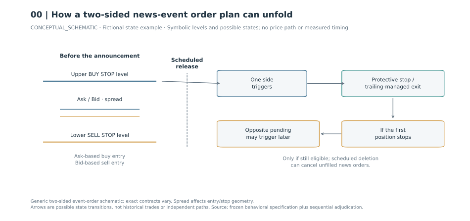
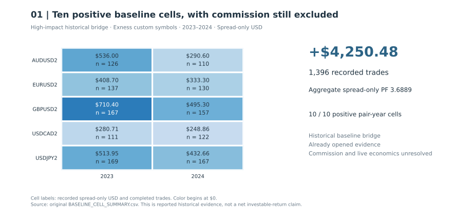
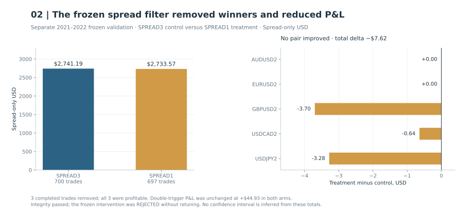
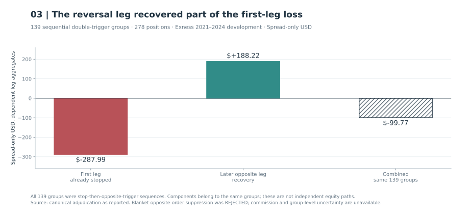

# MacroImpulse: the execution problem

## Why I shelved this

MacroImpulse tried to capture the abrupt price moves around scheduled economic releases. Historical results were encouraging under their stated cost assumptions, but live execution was the dealbreaker. Spreads widened around announcements, fills landed away from intended prices, and slippage ate into the move the strategy needed. **That’s why I shelved it: the execution conditions weren’t workable across the brokers I tried.** [My closeout note](../docs/provenance.md#macroimpulse-closeout-clarification)

This was a practical trading decision, not a new broker-by-broker measurement of live execution costs. The figures below show what the historical tests established and why those results were not enough.

## How the orders worked

Before a scheduled release, the strategy set a buy trigger above the market and a sell trigger below it. A move through either level could open a position. A wider spread changed how close the Ask was to the buy trigger and the Bid to the sell trigger. If the first position stopped out, a reversal could trigger the opposite order. [Execution rules](../docs/evidence.md#b08)

This diagram illustrates the order sequence. Its arrows represent possible actions. The distances between them have no measured price or time scale.

## What the baseline earned

The 2023–2024 high-impact baseline recorded **1,396 trades and +$4,250.48** across ten currency-pair and year combinations. All ten finished positive. These are historical US-dollar results after the modelled spread, before commission. [Baseline evidence](../docs/evidence.md#b09)

Those results described how the strategy behaved on historical quotes, not the prices a broker would actually fill during a release.

## Would a spread filter help?

I wanted to know whether skipping trades with a wide spread would keep the strategy out of its worst entries. In a separate frozen 2021–2022 comparison, the filter removed three completed trades. All three were winners. Spread-only profit fell by **$7.62**. Events that triggered both sides contributed the same total in both versions. I kept the decision to reject the filter. [Spread-filter validation](../docs/evidence.md#b09)

## What happened when both sides triggered?

An event that triggered both orders looked like a natural candidate to skip. Looking at the sequence changed how I read it. In all **139** double-trigger groups examined on the Exness sample, the first position had already stopped out before the second opened. The first legs lost **$287.99** in total and the reversal legs recovered **$188.22**, under spread-only accounting. [Sequential reversal evidence](../docs/evidence.md#b10)

Those totals describe two legs of the same events during 2021–2024 development. Blocking every reversal would also have removed the recovery. The research did not support that change. [Study scope](../docs/evidence.md#b10)

## What the tests could verify

Controlled comparisons with a reference strategy checked order triggers, stops and exits using the same ticks and parameters. They helped establish whether the implementation followed its intended rules. They could not establish whether a live trade during a news release would receive an economically viable fill. [Implementation checks](../docs/evidence.md#b08)

The public [aggregate data](../data/macro-public.json) and [figure renderer](../scripts/render_macro.py) reproduce these historical exhibits. Replaying the trades requires the original quotes and execution code. The [contribution record](../docs/ownership.md) explains my role and the AI assistance used in the research.
