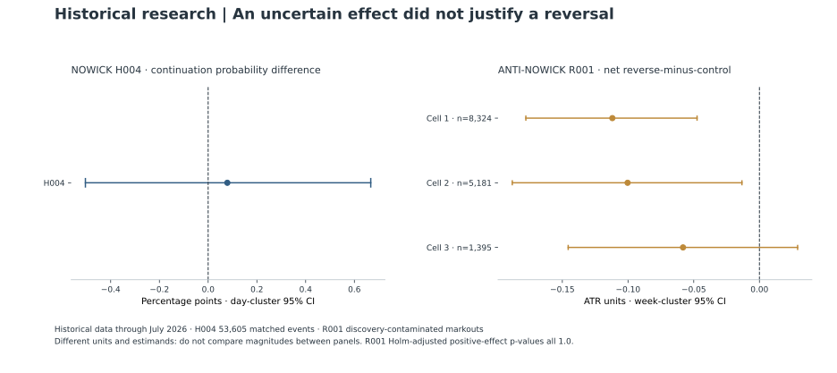

# Testing a candle pattern without manufacturing a reversal story

[Portfolio](../README.md) · [Evidence register](../docs/evidence.md) · [Published aggregates](../results/historical-tables.md)

The useful outcome of this research program was a decision to stop. I tested whether a visually distinctive candle pattern added predictive information beyond comparable ordinary candles, then evaluated a separately defined reversal hypothesis. The matched event study did not establish a robust incremental continuation signal. The independent reversal study also failed its frozen decision rule. Neither result justified another trading implementation.

This case shows how I separate an appealing market description from a testable claim: define the comparison, preserve execution accounting, quantify uncertainty, and retain a negative decision when the evidence does not clear the gate.

## The question behind the chart

A candle with almost no wick on one side can look informative. Its shape may also reflect direction, trend, volatility, or time of day that ordinary candles already capture. A directional association alone therefore does not establish that the distinctive wick supplies useful additional information.

The H004 study asked that narrower incremental question. It used directional 15-minute candles from four FX instruments over January 31, 2020 through July 31, 2026. The primary population was aligned with a frozen causal trend definition. The research implementation collected events without an order-transmission API. This was an event study, with an event-level continuation endpoint, rather than a portfolio backtest. [N1](../docs/evidence.md#n1)

## Matching before interpreting

Four tester runs produced 639,061 raw directional events. The common-window analysis retained 639,057 and explicitly excluded four boundary candles. All 53,605 eligible trend-aligned pattern events received five matched ordinary-candle controls; none remained unmatched. The analysis used frozen matching strata and deterministic output generation. [N1](../docs/evidence.md#n1)

The primary estimate compared post-retest continuation probabilities. A UTC-day cluster bootstrap with 10,000 replicates retained a shared-day dependence structure in the uncertainty calculation. The pooled difference was **+0.078668 percentage points**, with a **95% confidence interval from -0.503610 to +0.667196 percentage points**. [N1](../docs/evidence.md#n1)

The interval crossed zero. Three instrument estimates were positive but individually uncertain; the fourth was negative. The predefined cross-instrument decision rule did not pass. The recorded decision was **no robust incremental signal**. This does not prove that every conceivable use of the pattern has zero effect. It means the specific frozen claim was not supported by this comparison.

Secondary endpoints reinforced the need to keep the primary question fixed. One descriptive return difference was positive, while both underlying matched population means remained negative. A favorable difference is not automatically a favorable absolute outcome. Those event-level directional returns were also different from the primary continuation-probability endpoint. I did not use the secondary result to select a new filter or override the decision. [N1](../docs/evidence.md#n1)

Matching reduces specified differences between observed groups; it does not randomize market events. Residual confounding remains possible. The estimates describe historical conditional associations, without establishing causation or executable trading profitability.

## Why rejection does not imply reversal

A weak continuation result does not automatically validate taking the opposite side. Reversing a position changes which quote side is executable, incurs spread and other costs, and requires its own comparison population. I therefore treated reversal as an independent research contract, ANTI-NOWICK R001, without reopening or retuning the closed original program. [N2](../docs/evidence.md#n2)

R001 fixed three instrument/timeframe configurations. For each original filled opportunity, it compared a reversed fixed-clock markout with five deterministically matched reversed ordinary-candle controls. Controls were assigned before forward quotes were read. The primary endpoint was the 60-minute net difference, normalized by signal-time average true range (ATR), a volatility scale. Buy and sell accounting used the corresponding executable Bid/Ask sides, plus explicit commission and a fixed slippage allowance. These were research cost assumptions, not reconstructed historical broker fills. [N2](../docs/evidence.md#n2)

Source and parity checks passed in all three configurations. Complete matched groups numbered 8,324, 5,181, and 1,395. The net reverse-minus-control estimates were **-0.111939 ATR**, **-0.100320 ATR**, and **-0.058142 ATR**, respectively. Their week-cluster 95% intervals were **[-0.177759, -0.047463]**, **[-0.188084, -0.013322]**, and **[-0.145536, +0.029060]**. The reported Holm-adjusted p-values for the intended positive-effect test were all 1.0. [N2](../docs/evidence.md#n2)

No configuration met the frozen positive-effect gate. All three point estimates were negative, and the fixed year-stability diagnostic also failed. The formal result was **R001_REJECT**. No reversed trading implementation followed.

## What the evidence earns

The reversal history, January 2020 through July 2026, had already been inspected in related research. It is explicitly discovery-contaminated and cannot be presented as a fresh holdout. The original event study likewise supplies historical research evidence, not prospective validation. [N1](../docs/evidence.md#n1) [N2](../docs/evidence.md#n2)

The practical contribution is an auditable stopping decision: complete matching receipts, disclosed exclusions, dependence-aware uncertainty, explicit cost assumptions, and a recorded boundary between a failed hypothesis and its proposed successor. The program did not produce a deployable strategy. It produced evidence sufficient to avoid building another one under the tested contract.

The [evidence register](../docs/evidence.md) describes the underlying records and public verification boundary. Tick data, execution ledgers and strategy artifacts remain private.
