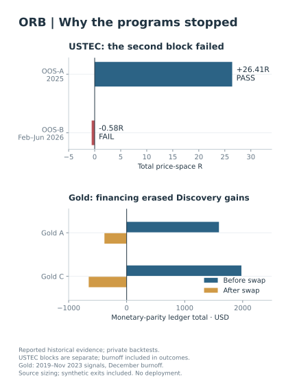
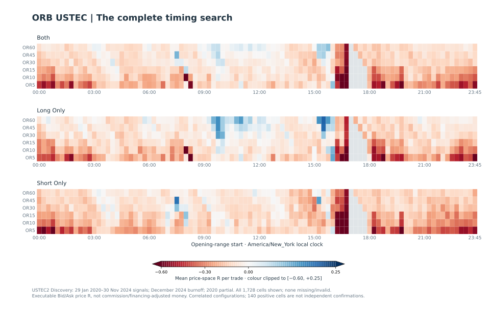
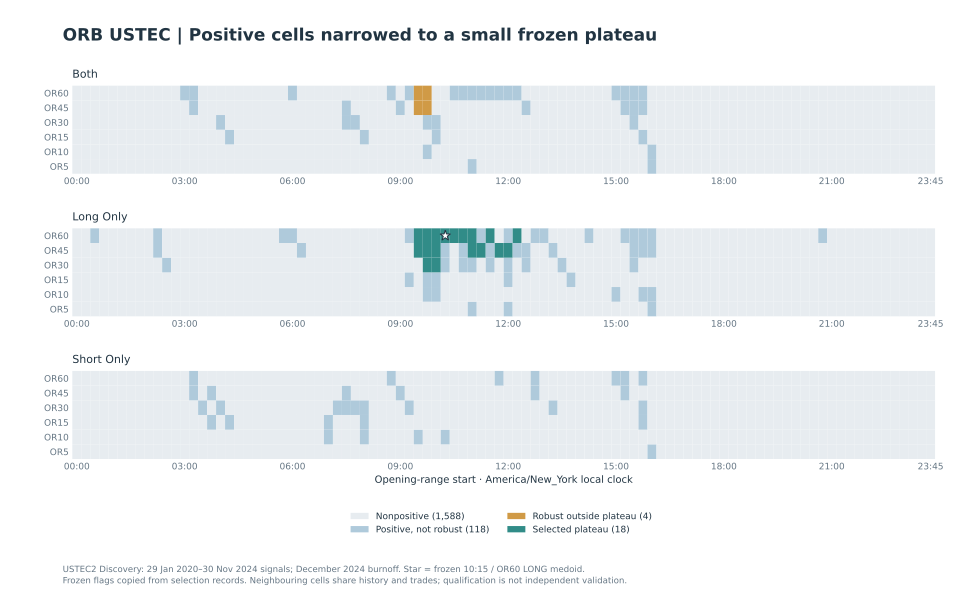
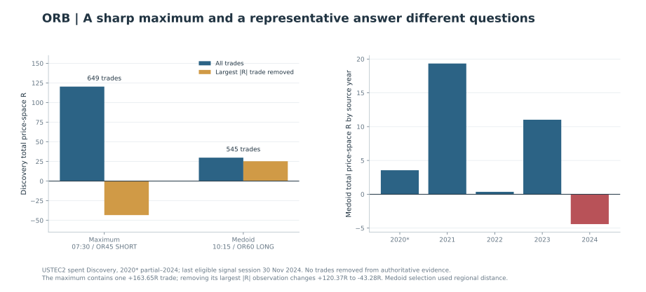
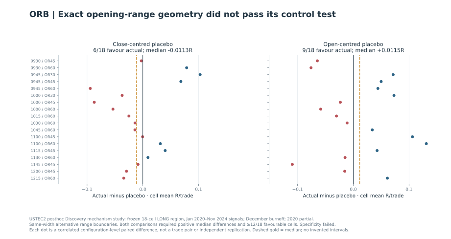
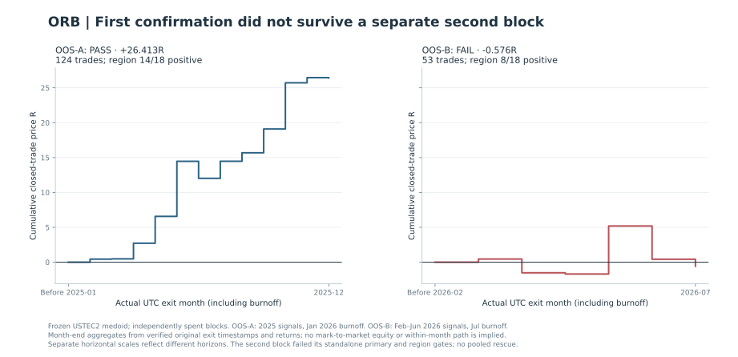
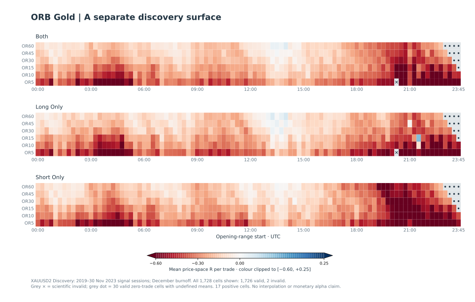
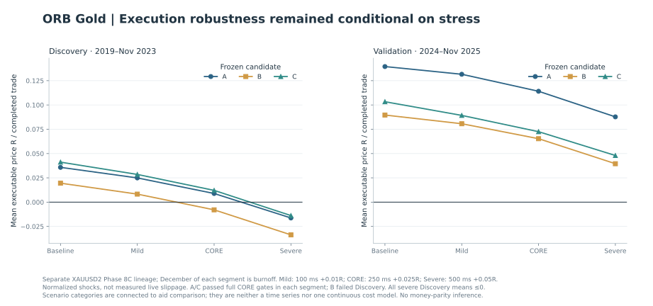
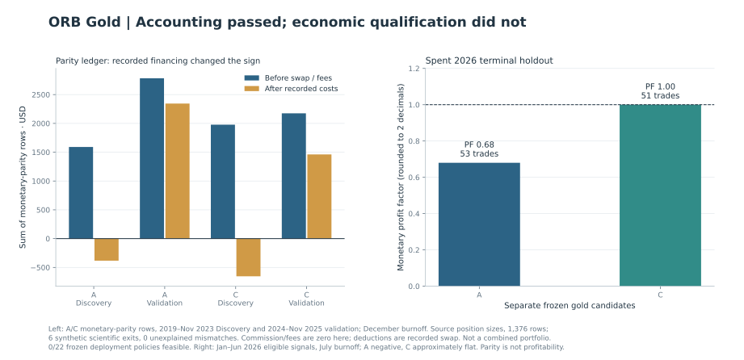

# Opening Range Breakout: testing the boundary and the economics

[Portfolio](../README.md) · [Figure evidence and blockers](../docs/orb-visual-evidence.md) · [Evidence register](../docs/evidence.md) · [Published aggregates](../results/historical-tables.md)

Does crossing the opening range predict continuation, or would a simpler time-of-day momentum rule explain the result? The Nasdaq study challenged the range geometry with placebo boundaries, then encountered conflicting independent validation. A separate gold lineage passed implementation parity but failed economic qualification. The tested program closed for deployment.

The index and gold studies used separate histories and decision gates. [Other ORB branches](opening-range-atlas.md) include promising Discovery candidates whose OOS was never opened; those remain unadjudicated.

The first index confirmation did not persist in the next frozen block. Gold passed implementation parity, then failed economic qualification. The figures show the searches and tests behind those decisions. [Open full-resolution summary](../figures/orb-summary.svg)

## From opening range to trade rules

The intuition is continuation: define an early range, wait for a completed candle beyond its boundary, then trade toward a fixed target with a predefined stop. Testing it requires a clock, executable entry and order lifetime.

Illustrative setup, optional rules and tested implementation scope

Define an opening range by recording the high and low of a designated early-session window. One practical configuration uses the first **15 minutes** after New York opens (9:30 to 9:45 a.m. Eastern Time), or the first **30 minutes** around London (3:00 to 3:30 a.m. Eastern) or Asia (9:00 to 9:30 a.m. UTC+9). Wait for a **five-minute candle to close beyond the range** before considering a continuation trade. These illustrate the setup; each research contract fixes its own clock.

One mechanical variant places the stop-loss at the **opening-range midpoint** and its target at a Fibonacci-tool **1 standard-deviation (STDV) level**. If the close leaves at least **1R** of potential reward to that target, it may enter at market. Otherwise, it can use a **limit order at a retest of the broken range boundary**, cancelling the pending order if the target is reached before entry. It can also distinguish breaks with versus against the first five-minute candle's direction.

A discretionary version may avoid breakouts near previous-session highs/lows when little apparent liquidity lies beyond; stop for the day after **two losses** or **one win**; or consider runner management in specified trend/liquidity contexts. These optional choices were not all implemented in the tested contracts.

The research contracts specify clocks, completed-candle signals, market/retest order handling, executable quote conventions and trade lifecycles. The recorded original-geometry implementation used a midpoint stop and structural target, but the equivalence between its exact target calculation and the illustrative **1 STDV Fibonacci target is not independently certified**. The economic results below apply only to the researched versions, not every possible discretionary rule combination.

The [public aggregates](../data/orb-ustec-public.json) retain every index configuration and identify the original artifacts by hash. They reproduce these figures from completed historical experiments; the private backtest cannot be replayed from this bundle. All empirical figures are **EMPIRICAL_REPORTED**; none is a fresh test or a live trading record.

The opening-range breakout program closed on September 30, 2026 without authorizing deployment. Some economic hypotheses had failed; some candidates stopped after conflicting validation; others were parked with promising Discovery results and unopened OOS. The unperformed tests have no result. [O6](../docs/evidence.md#o6)

For example, one filtered momentum candidate's Discovery record showed 114 trades, approximately +44.67R, profit factor 2.79 and seven positive calendar years. Its sealed OOS was never opened under that lineage. It was parked and remains scientifically unadjudicated out of sample; the closure must not be rewritten as an OOS rejection. The separate atlas retains that branch and the other exploratory ridges alongside the completed negative studies. [A04](../docs/evidence.md#a04)

This case study covers separate index and gold research lineages. Their results must remain separate: they used different histories, eligibility rules and validation splits. All figures come from completed historical private research reports, not a public replication or a live trading record. Where results use price-space R, R means price movement normalized by the trade's initial executable risk distance. It is not an account return or automatically a financing-adjusted profit measure.

| Research contract | Identity and decision |
| --- | --- |
| System and instruments | ORB opening-range breakout research engine, with Python research and MQL5 parity lineages; USTEC2 Nasdaq equity-index CFD and XAUUSD2 gold CFD. |
| Clock | Intraday opening-range windows, M5 signal confirmation and tick-level trade lifecycle accounting. These clocks serve different purposes. |
| Comparison | A timing-region representative versus frozen gates and width-preserving geometry controls; the separate gold lineage additionally tests implementation and monetary accounting. |
| Sample | Index Discovery: 2020 to 2024; sequential validation blocks in 2025 and 2026. Gold Discovery: 2019 to 2023, validation: 2024 to 2025, terminal: eligible January to June 2026 sessions. |
| Decision | Index second-block failure; gold parity pass followed by economic/terminal failure. Unopened Discovery successors remain unadjudicated. |
| Contribution | Experiment governance and preserved negative decisions; automated searches and replay, with AI-assisted public engineering. [Ownership](../docs/ownership.md) |

Sources: [O1 to O6](../docs/evidence.md#o1). Specific eligibility and lifecycle fences below take precedence over these short calendar summaries.

## Selecting a representative region

The index study began with 1,728 timing configurations on available Discovery history from January 29, 2020 through December 2024. The first year was partial. Only 140 configurations had positive total R; 22 met the frozen robustness criteria. One eligible long-side plateau contained 18 configurations. [O1](../docs/evidence.md#o1)

Each coloured cell is an actual configuration mean from the original matrix. The small positive morning region sits inside a much larger negative surface. The shared colour scale has a visible zero and explicitly clips extreme colour values; the underlying values remain intact. [Full-resolution surface](../figures/orb-ustec-surface.svg) · [Data and definitions](../data/orb-ustec-public.json)

Positive performance alone did not qualify a candidate. The map retains the original robustness and plateau flags, including the small robust BOTH region that failed plateau eligibility. The star marks the representative selected from the eligible LONG region. These are correlated configurations, not independent confirmations. [Full-resolution qualification map](../figures/orb-ustec-qualification.svg) · [Frozen criteria](../docs/orb-visual-evidence.md#selection-contract)

For that index mechanism study, new Discovery signals were eligible only through November 30, 2024. December supplied lifecycle completion, not another eligible signal month. The physical data span and the scientific entry window therefore differ. [O1](../docs/evidence.md#o1)

The selection rule chose a medoid to represent the plateau. It produced 545 trades, approximately +29.87 price-space R and a profit factor of 1.09. Selection used its position within the region instead of the highest historical return. [O1](../docs/evidence.md#o1)

The maximum was highly concentrated. The surface's global maximum had approximately +120.37R overall, but one trade contributed +163.65R. Removing that single largest absolute-R observation left approximately −43.28R. The original backtest remains unchanged; this removal diagnostic shows how much its maximum depended on one trade. [O1](../docs/evidence.md#o1)

The highest total and the representative answer different questions. The medoid avoids the maximum's extreme concentration, while its annual breakdown still exposes instability. The removal bars are diagnostics copied from the frozen report; the original results remain unchanged. [Full-resolution selection comparison](../figures/orb-ustec-selection.svg)

## Selection risk after searching many configurations

The 1,728 configurations share history, neighboring windows and often trades. Their maximum is selected using observed outcomes; its ordinary single-configuration uncertainty would ignore that selection. The 22 survivors are 1.27% of the search and the positive cells are 8.10%, descriptive fractions rather than significance levels. A medoid reduces the temptation to select the sharpest local winner, but the region containing it was also selected on Discovery outcomes. It does not erase the search. [O1](../docs/evidence.md#o1)

If every cell had supplied a valid marginal test, a Bonferroni family threshold would be 0.05/1,728, about 0.00002894. This is a hypothetical multiplicity illustration; the historical archive does **not** supply those tests, so it is not an adjusted result or a verdict on this candidate. Correlation can make that bound conservative, but does not justify dividing the search count by an invented effective-trial estimate. [O1](../docs/evidence.md#o1)

The public aggregates cannot identify a probability of backtest overfitting, deflated Sharpe ratio or selection-adjusted p-value. Those would require the complete synchronized candidate return matrix, all searched variants and selection steps, valid cost accounting and an appropriate dependence model. Publishing a new number from only the chosen representative would manufacture missing information. Those diagnostics remain **NOT ESTIMABLE FROM PUBLIC AGGREGATES**.

The study froze a representative, tested mechanism controls and stopped after a later validation block failed. Geometry controls were a post-hoc Discovery investigation, not a retroactive preregistration of the original timing search. Combining validation blocks after seeing one fail would answer a different, selected question. The next study should freeze the full candidate family, nested selection procedure, multiplicity policy and temporal fences before access; this historical case cannot recover that prospective design. [O1](../docs/evidence.md#o1) [O2](../docs/evidence.md#o2)

## Testing what the geometry actually explained

A timing plateau does not establish the mechanism used to name it. The next study compared the actual high/low range with same-width synthetic ranges centered on alternative reference prices, alongside simpler clock and bullish-candle controls. The candidate stayed frozen throughout this posthoc Discovery investigation. [O1](../docs/evidence.md#o1)

Across the 18 robust configurations, actual geometry's median paired advantage over the close-centered placebo was approximately −0.0113R per trade. Actual geometry did better in only six configurations. Against the open-centered placebo, its median paired advantage was positive, approximately +0.0115R, but only nine configurations favored it. The frozen requirement demanded positive median advantages against both placebos and at least 12 favorable comparisons out of 18. It failed. [O1](../docs/evidence.md#o1)

The paired comparisons challenge the precise boundary, keeping the range width and frozen candidate fixed. A median of paired differences is not the difference between separate medians. No confidence interval is invented for these correlated cell comparisons. [Full-resolution placebo comparisons](../figures/orb-ustec-controls.svg) · [Original comparison projection](../data/orb-ustec-public.json)

The special-geometry claim failed this test. Predictive content in the broader timing region remained unresolved, as did any alternative causal explanation. The frozen candidate proceeded to its authorized validation with that mechanism claim unsupported.

## Independent validation: first pass, second failure

These are genuine closed-trade aggregates from authenticated exit timestamps, including lifecycle burnoff. They do not show an intramonth price path or mark-to-market equity. Each block starts from zero and retains its own gate. [Full-resolution validation curves](../figures/orb-ustec-validation.svg)

The first out-of-sample block was strong. Across eligible 2025 sessions, the representative recorded 124 trades, +26.41 price-space R, mean +0.213R and profit factor 1.382. Fourteen of the 18 frozen regional configurations had positive total R. Both candidate and region gates passed. [O2](../docs/evidence.md#o2)

The subsequent block tested eligible sessions from February through June 2026. January had already been consumed by lifecycle completion for the preceding study; July was reserved for burnoff. A month used to finish an existing position is already spent evidence.

The second block produced 53 trades, −0.576R and profit factor 0.982. Only eight of 18 regional configurations were positive, and the median configuration mean was negative. Both standalone confirmation gates failed. [O2](../docs/evidence.md#o2)

Combining the two blocks still produced positive cumulative OOS R. That did not reverse the decision. The second block's gate had been defined independently, and the correlated neighboring configurations were not 18 independent replications. The recorded action was to stop. Returning to Discovery to repair the candidate after this result would have changed the experiment. [O2](../docs/evidence.md#o2)

## A separate gold lineage: correct implementation first

The separate modern original-geometry gold surface had 17 positive cells among 1,726 valid configurations. It used UTC anchors, different years and a different freeze from the index study. Grey does not mean zero return: crosses identify invalid evidence and dots identify valid configurations without trades. [Full-resolution gold surface](../figures/orb-gold-surface.svg) · [Gold aggregate definitions](../data/orb-gold-public.json)

The gold research asked a different set of questions on Discovery history in 2019 to 2023 and validation history in 2024 to 2025. Eligibility fences excluded the final month of each segment from new signals while permitting existing lifecycle completion. Three candidates were frozen before the later checks.

Reproducing the scientific behavior between Python and MT5 required forensic work. Comparisons joined canonical scientific keys and examined opening ranges, signals, decisions, orders, fills, trade outcomes and path diagnostics. The completed final parity record passed for all three candidates with zero semantic mismatches. Earlier failed attempts remained part of the record; they were superseded by the documented final certificate. [O3](../docs/evidence.md#o3)

This was a scoped scientific parity result. Scientific lifecycle handling included explicitly identified synthetic exits, while physical deal records remained separate. Passing those comparisons did not establish live execution quality or profitability on every broker.

Execution stress came next. Two candidates, A and C, passed the frozen core test independently in Discovery and validation. A third failed in Discovery. More severe stress pushed every candidate's Discovery result to breakeven or below. These were normalized cost and latency shocks, not measured promises about live slippage. [O4](../docs/evidence.md#o4)

The lines connect discrete stress scenarios rather than dates. The full CORE gate also constrained profit factor and drawdown; a positive mean alone was insufficient. Passing implementation and stress checks still left monetary qualification unresolved. [Full-resolution execution comparison](../figures/orb-gold-stress.svg)

## Financing changed the economic conclusion

Monetary accounting then reconciled 1,376 trades with zero unexplained mismatches. That accounting pass was followed by a deployment failure: none of 22 frozen policy and risk configurations satisfied the complete gate. A favorable validation period could not compensate for failed Discovery economics. [O4](../docs/evidence.md#o4)

This ledger supplies a direct economic comparison: at its recorded position sizes, financing changed both candidates' Discovery totals from positive to negative. It contains six explicitly synthetic scientific exits, and is narrower than a physical broker-account or live-fill qualification. The separate terminal bars keep their reported rounding. Neither favourable validation nor accounting parity rescued the frozen deployment gate. [Full-resolution economics](../figures/orb-gold-economics.svg) · [Monetary definitions and limits](../docs/orb-visual-evidence.md#gold-accounting-boundary)

The historical inspection reports showed only a thin margin before further qualification. Over the combined historical segments, candidate A had profit factor approximately 1.047 and C approximately 1.013. Both carried substantial overnight exposure and financing charges. These pooled figures were descriptive and did not supersede the failed qualification. The final program postmortem concluded that financing consumed much of the overnight-dependent gross advantage and that the tested broker-portability investigation did not rescue it. [O4](../docs/evidence.md#o4) [O6](../docs/evidence.md#o6)

This changed the order I would use for future research. A strategy that depends on holding through rollover needs financing analysis early. A fixed time exit, a different instrument or revised geometry might avoid a cost, but each changes the hypothesis and needs its own admissible evidence plan.

## Valid terminal tests, unsuccessful candidates

The final opened gold holdout covered eligible January to June 2026 sessions, with July reserved for lifecycle completion. A produced 53 trades and profit factor 0.68: economically negative. C produced 51 trades and profit factor 1.00 after rounding: economically flat. Both runs were valid and complete. Neither result supported economic continuation. That holdout is now spent historical evidence. [O5](../docs/evidence.md#o5)

A separate failed-breakout Fade baseline also failed. On its frozen 2003 to 2014 Discovery sample it closed 781 trades, lost approximately 320.30 net R, and recorded profit factor 0.251. None of its 12 calendar years was positive. Integrity checks passed before economic analysis, and the baseline was rejected without opening its OOS gate. Executable accounting rejected this reversal baseline before its OOS was opened. [OF](../docs/evidence.md#of)

The September 2026 closeout covers the tested lineages. Other opening-range strategies and the separately registered successor still need their own evidence. The program left reusable methods for representative selection, concentration checks, placebo controls, canonical-key parity and lifecycle fences, with monetary accounting and stop decisions recorded separately. [O6](../docs/evidence.md#o6)
