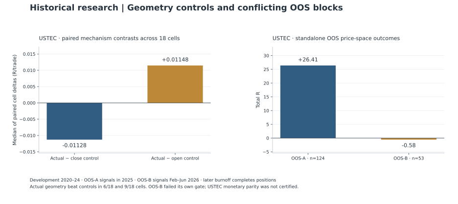

# ORB on USTEC2 and XAUUSD2: selection risk, conflicting validation and financing

[Portfolio](../README.md) · [Evidence register](../docs/evidence.md) · [Published aggregates](../results/historical-tables.md)

This opening-range breakout program ended with several different decisions: rejected economic hypotheses, mixed-evidence candidates stopped by a later gate, and promising Discovery candidates parked before OOS. None had deployment authorization when the historical program closed on September 30, 2026. Its value lies in preserving those distinctions. A branch closed for budget or governance reasons has not thereby failed an unperformed test. [O6](../docs/evidence.md#o6)

One filtered momentum candidate illustrates the boundary: its Discovery record showed 114 trades, approximately +44.67R, profit factor 2.79 and seven positive calendar years. Its sealed OOS was never opened under that lineage. It was parked and remains scientifically unadjudicated out of sample; the closure must not be rewritten as an OOS rejection. The separate atlas retains that branch and the other exploratory ridges alongside the completed negative studies. [A04](../docs/evidence.md#a04)

This case study covers separate index and gold research lineages. Their results must remain separate: they used different histories, eligibility rules and validation splits. All figures come from completed historical private research reports, not a public replication or a live trading record. Where results use price-space R, R means price movement normalized by the trade's initial executable risk distance. It is not an account return or automatically a financing-adjusted profit measure.

| Research contract | Identity and decision |
| --- | --- |
| System and instruments | ORB opening-range breakout research engine, with Python research and MQL5 parity lineages; USTEC2 Nasdaq equity-index CFD and XAUUSD2 gold CFD. |
| Clock | Intraday opening-range windows, M5 signal confirmation and tick-level trade lifecycle accounting. These clocks serve different purposes. |
| Comparison | A timing-region representative versus frozen gates and width-preserving geometry controls; the separate gold lineage additionally tests implementation and monetary accounting. |
| Sample | Index Discovery: 2020–2024; sequential validation blocks in 2025 and 2026. Gold Discovery: 2019–2023, validation: 2024–2025, terminal: eligible January–June 2026 sessions. |
| Decision | Index second-block failure; gold parity pass followed by economic/terminal failure. Unopened Discovery successors remain unadjudicated. |
| Contribution | Experiment governance and preserved negative decisions; automated searches and replay, with AI-assisted public engineering. [Ownership](../docs/ownership.md) |

Sources: [O1–O6](../docs/evidence.md#o1). Specific eligibility and lifecycle fences below take precedence over these short calendar summaries.

## Selecting a representative region

The index study began with 1,728 timing configurations on available Discovery history from January 29, 2020 through December 2024. The first year was partial. Only 140 configurations had positive total R; 22 met the frozen robustness criteria. One eligible long-side plateau contained 18 configurations. [O1](../docs/evidence.md#o1)

For that index mechanism study, new Discovery signals were eligible only through November 30, 2024. December supplied lifecycle completion, not another eligible signal month. The physical data span and the scientific entry window therefore differ. [O1](../docs/evidence.md#o1)

The selection rule chose a representative medoid from that plateau, rather than the configuration with the highest historical return. The representative produced 545 trades, approximately +29.87 price-space R and a profit factor of 1.09. Its value was its place in the region, not an exceptional headline. [O1](../docs/evidence.md#o1)

Concentration diagnostics made the distinction concrete. The surface's global maximum had approximately +120.37R overall, but one trade contributed +163.65R. Removing that single largest absolute-R observation left approximately −43.28R. This sensitivity did not delete or amend the authoritative backtest. It showed why a dramatic maximum can be a poor research candidate. [O1](../docs/evidence.md#o1)

## What the search can and cannot establish

The 1,728 configurations share history, neighboring windows and often trades. Their maximum is selected using observed outcomes; its ordinary single-configuration uncertainty would ignore that selection. The 22 survivors are 1.27% of the search and the positive cells are 8.10%, descriptive fractions rather than significance levels. A medoid reduces the temptation to select the sharpest local winner, but the region containing it was also selected on Discovery outcomes. It does not erase the search. [O1](../docs/evidence.md#o1)

If every cell had supplied a valid marginal test, a Bonferroni family threshold would be 0.05/1,728, about 0.00002894. This is a hypothetical multiplicity illustration; the historical archive does **not** supply those tests, so it is not an adjusted result or a verdict on this candidate. Correlation can make that bound conservative, but does not justify dividing the search count by an invented effective-trial estimate. [O1](../docs/evidence.md#o1)

The public aggregates cannot identify a probability of backtest overfitting, deflated Sharpe ratio or selection-adjusted p-value. Those would require the complete synchronized candidate return matrix, all searched variants and selection steps, valid cost accounting and an appropriate dependence model. Publishing a new number from only the chosen representative would manufacture missing information. Those diagnostics remain **NOT ESTIMABLE FROM PUBLIC AGGREGATES**.

The actual defense was a frozen representative followed by separate validation, disclosed mechanism controls and a stop after a failed later block. Geometry controls were a post-hoc Discovery investigation, not a retroactive preregistration of the original timing search. Combining validation blocks after seeing one fail would answer a different, selected question. The next study should freeze the full candidate family, nested selection procedure, multiplicity policy and temporal fences before access; this historical case cannot recover that prospective design. [O1](../docs/evidence.md#o1) [O2](../docs/evidence.md#o2)

## Testing what the geometry actually explained

A timing plateau does not establish the mechanism used to name it. The next study compared the actual high/low range with same-width synthetic ranges centered on alternative reference prices, alongside simpler clock and bullish-candle controls. The candidate stayed frozen throughout this posthoc Discovery investigation. [O1](../docs/evidence.md#o1)

Across the 18 robust configurations, actual geometry's median paired advantage over the close-centered placebo was approximately −0.0113R per trade. Actual geometry did better in only six configurations. Against the open-centered placebo, its median paired advantage was positive, approximately +0.0115R, but only nine configurations favored it. The frozen requirement demanded positive median advantages against both placebos and at least 12 favorable comparisons out of 18. It failed. [O1](../docs/evidence.md#o1)

That rejected the narrow claim of special geometry specificity. It did not establish that the broader timing region had no predictive content, nor prove a replacement causal explanation. The distinction allowed the frozen candidate to proceed to its authorized validation without upgrading an unsupported mechanism story.

## When the next OOS block disagreed

The first out-of-sample block was strong. Across eligible 2025 sessions, the representative recorded 124 trades, +26.41 price-space R, mean +0.213R and profit factor 1.382. Fourteen of the 18 frozen regional configurations had positive total R. Both candidate and region gates passed. [O2](../docs/evidence.md#o2)

The subsequent block tested eligible sessions from February through June 2026. January had already been consumed by lifecycle completion for the preceding study; July was reserved for burnoff. This matters because a month used to finish an existing position is not untouched evidence available for a new signal sample.

The second block produced 53 trades, −0.576R and profit factor 0.982. Only eight of 18 regional configurations were positive, and the median configuration mean was negative. Both standalone confirmation gates failed. [O2](../docs/evidence.md#o2)

Combining the two blocks still produced positive cumulative OOS R. That did not reverse the decision. The second block's gate had been defined independently, and the correlated neighboring configurations were not 18 independent replications. The recorded action was to stop rather than return to Discovery and repair the strategy after seeing the result. [O2](../docs/evidence.md#o2)

## A separate gold lineage: correct implementation first

The gold research asked a different set of questions on Discovery history in 2019–2023 and validation history in 2024–2025. Eligibility fences excluded the final month of each segment from new signals while permitting existing lifecycle completion. Three candidates were frozen before the later checks.

Reproducing the scientific behavior between Python and MT5 required forensic work. Comparisons joined canonical scientific keys and examined opening ranges, signals, decisions, orders, fills, trade outcomes and path diagnostics. The completed final parity record passed for all three candidates with zero semantic mismatches. Earlier failed attempts remained part of the record; they were superseded by the documented final certificate. [O3](../docs/evidence.md#o3)

This was a scoped scientific parity result. Scientific lifecycle handling included explicitly identified synthetic exits, while physical deal records remained separate. Passing those comparisons did not establish live execution quality or profitability on every broker.

Execution stress came next. Two candidates, A and C, passed the frozen core test independently in Discovery and validation. A third failed in Discovery. More severe stress pushed every candidate's Discovery result to breakeven or below. These were normalized cost and latency shocks, not measured promises about live slippage. [O4](../docs/evidence.md#o4)

## Financing changed the economic conclusion

The next layer reconciled monetary accounting across 1,376 trades with zero unexplained mismatches. That accounting pass was followed by a deployment failure: none of 22 frozen policy and risk configurations satisfied the complete gate. A favorable validation period could not compensate for failed Discovery economics. [O4](../docs/evidence.md#o4)

The native historical inspection reports also showed how narrow the remaining economics were. Over the combined historical segments, candidate A had profit factor approximately 1.047 and C approximately 1.013. Both carried substantial overnight exposure and financing charges. These pooled figures were descriptive and did not supersede the failed qualification. The final program postmortem concluded that financing consumed much of the overnight-dependent gross advantage and that the tested broker-portability investigation did not rescue it. [O4](../docs/evidence.md#o4) [O6](../docs/evidence.md#o6)

This changed the order I would use for future research. A strategy that depends on holding through rollover needs financing analysis early. A fixed time exit, a different instrument or revised geometry might avoid a cost, but each changes the hypothesis and needs its own admissible evidence plan.

## Valid terminal tests, unsuccessful candidates

The final opened gold holdout covered eligible January–June 2026 sessions, with July reserved for lifecycle completion. A produced 53 trades and profit factor 0.68: economically negative. C produced 51 trades and profit factor 1.00 after rounding: economically flat. Both runs were valid and complete. Neither result supported economic continuation. That holdout is now spent historical evidence. [O5](../docs/evidence.md#o5)

A separate failed-breakout Fade baseline supplied another useful negative result. On its frozen 2003–2014 Discovery sample it closed 781 trades, lost approximately 320.30 net R, and recorded profit factor 0.251. None of its 12 calendar years was positive. Integrity checks passed before economic analysis, and the baseline was rejected without opening its OOS gate. It demonstrated that a visually persuasive reversal pattern can fail decisively under executable accounting. [OF](../docs/evidence.md#of)

The resulting September 2026 closeout applies to the historical lineages actually tested, not every conceivable opening-range strategy or a separately registered successor experiment. What survived was the research machinery: representative selection, concentration checks, placebo controls, canonical-key parity, lifecycle fences, separate monetary accounting and enforceable stop decisions. The failed candidates remain useful evidence precisely because their conclusions were preserved. [O6](../docs/evidence.md#o6)
