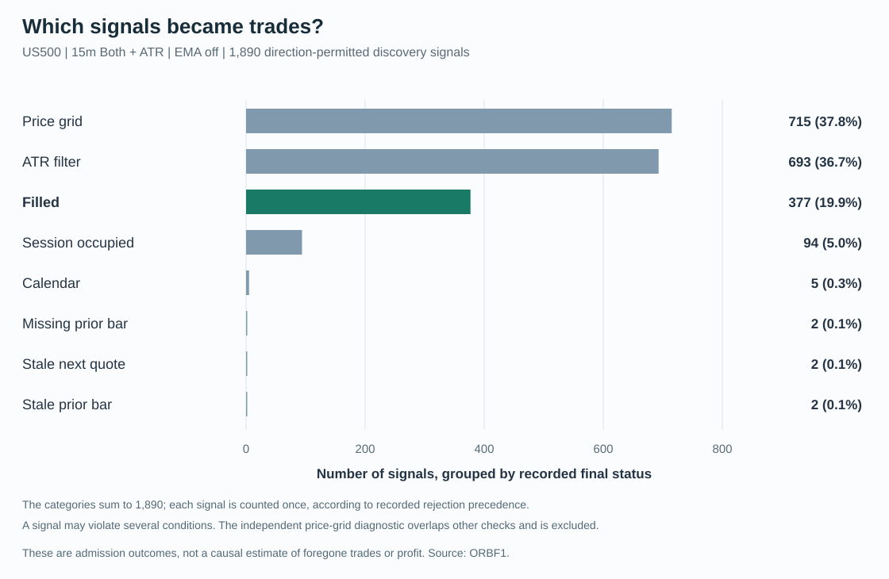
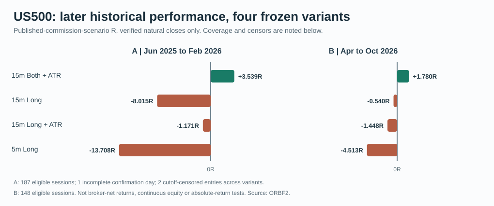
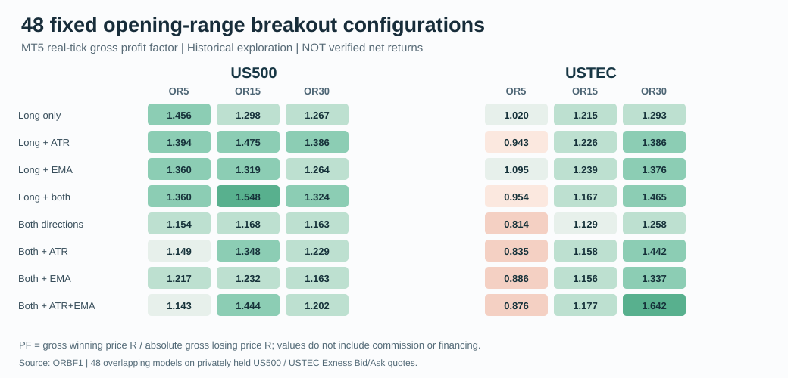

# ORB setup and filters: technical appendix

[Main case study](orb-setup-filters.md) · [Public aggregates](../data/orb-setup-filters-public.json) · [Discovery source](../docs/evidence.md#orbf1) · [Later source](../docs/evidence.md#orbf2)

This appendix records the details behind the readable case study. It preserves the original research outcomes while making selection, execution, missingness, inference, and public reproducibility boundaries explicit. The rationale in the main article is a hypothesis about the rules, not evidence that the proposed mechanism caused the observed returns.

## Exact strategy specification

The baseline is a cash-open ORB with midpoint range construction and completed-candle confirmation. US500 and USTEC refer to the tested Exness CFD quote histories. They are not exchange futures or cash-index execution records. [ORBF1](../docs/evidence.md#orbf1)

| Component | Implementation detail |
| --- | --- |
| Clock | 09:30 America/New_York, date-aware daylight saving time |
| Range | Midpoint `(Bid + Ask) / 2` high and low over 5, 15, or 30 minutes from the anchor |
| Confirmation | Completed M15 midpoint candle, even for a 5- or 30-minute range |
| Previous candle | Adjacent completed M15 candle must close inside the range, boundaries inclusive |
| Long / short | Signal close strictly above the range high / below the range low; shorts only when bidirectional |
| First confirmation | 10:00 New York for OR5/OR15; 10:15 for OR30 |
| Last signal | Candle starting 11:45 and completing 12:00; entry on its next eligible quote |
| Fills | Long entry Ask, exit Bid; short entry Bid, exit Ask |
| Stop | Opposite range boundary |
| Target | 1.5 initial price R from actual entry |
| Management | No scheduled liquidation, breakeven, or trailing stop |
| Position constraint | One currently open position per entry session, with possible overlap across sessions |

These are fixed research specification choices, not established optimal settings. A shorter range does not move confirmation off the M15 clock. One open position per session also does not mean one trade per day: another eligible signal may be admitted after the session's previous position closes. [ORBF1](../docs/evidence.md#orbf1)

The optional ATR filter uses Wilder ATR(1344) on completed M15 midpoint bars and admits range-width / ATR within [1.25, 3.0], inclusive. It samples ATR at the completion of the bar containing the range end: 09:45 for OR5/OR15, 10:00 for OR30. [ORBF1](../docs/evidence.md#orbf1)

The later EMA200 extension uses completed M15 midpoint closes, seeded with the arithmetic average of the first 200 closes, then updated with weight 2/201. The completed signal candle is included. Long signals must close strictly above EMA and short signals strictly below; equality or unavailable EMA rejects. Both ATR and EMA update on all available completed CFD bars before the cash-session entry checks, including outside that session. [ORBF1](../docs/evidence.md#orbf1)

Quote freshness is also part of admission: the first range quote must be within 60 seconds of the anchor, the last range quote within 90 seconds of the exact range end, previous/signal candle last quotes within 90 seconds of their closes, and the next executable quote within 60 seconds of confirmation. The adjacent previous bar must exist. [ORBF1](../docs/evidence.md#orbf1)

## Execution and native qualification

Native MT5 Model 4 tests used an isolated diagnostic contract: tick size 0.01, minimum and step volume 0.10 lots, contract size 1 in USD, hedging mode 2, zero stop/freeze levels, and margin rate 0.005. This contract supports a controlled execution experiment. It does not authenticate the historical account's tradable size, margin, financing, or actual fills. [ORBF1](../docs/evidence.md#orbf1)

**Raw off-grid stops and targets were rejected, not rounded.** The following mutually exclusive recorded statuses account for the selected US500 OR15 bidirectional ATR-on EMA-off discovery candidate. Counts follow the implementation's rejection precedence; a signal can violate more than one condition even though it receives one final status. [ORBF1](../docs/evidence.md#orbf1)



The bars show final-status accounting, not a sequence of hypothetical trades removed by each check. They sum to the same **1,890 direction-permitted signals** in the table below. Counts cannot establish how rejected signals would have performed. [ORBF1](../docs/evidence.md#orbf1)

| Recorded status | Signals |
| --- | ---: |
| ATR filter | 693 |
| Off-grid price | 715 |
| Filled | 377 |
| Session already occupied | 94 |
| Calendar unknown or closed | 5 |
| Missing previous bar | 2 |
| Stale next quote | 2 |
| Stale previous bar | 2 |
| **Total direction-permitted signals** | **1,890** |

A separate independent grid diagnostic counted 1,192 violations, overlapping other failures. It is not an alternative count of uniquely rejected trades. This distinction prevents treating a mechanical rejection diagnostic as a causal estimate of lost profit. [ORBF1](../docs/evidence.md#orbf1)

All 48 discovery configurations received native qualification. That means recorded native fills, exits, price admission, and position handling were reconciled under the declared contract. Strict floating-reference comparison remained separate: the primary US500 row has native status `PASS` but strict reference status `FAIL_DIFF_EXPLAINED`, with six recorded differences. The study does not claim exact Python/MQL agreement across all signals. [ORBF1](../docs/evidence.md#orbf1)

All eight later US500 cohort/configuration cells passed the bounded native lifecycle check after a reviewed startup repair recovered the 332,352-tick warmup prefix for Cohort A. The repair addressed initialization, with no strategy-parameter change. The failed startup evidence was retained. [ORBF2](../docs/evidence.md#orbf2)

Holding is not limited to the cash session. In the selected discovery candidate, 67 of 377 trades crossed a New York date, the longest lasted approximately 118.75 hours, and the worst gross outcome was about -1.537R. Stops therefore do not guarantee a maximum realized loss of exactly 1R when prices gap. [ORBF1](../docs/evidence.md#orbf1)

## Candidate selection

The discovery design crossed 2 markets, 3 range lengths, 2 directions, and both states of ATR and EMA, producing 48 configurations. The matrix preceded the factorial outcomes, but the source history had already been inspected. The 10,895 reported trade observations overlap across variants; they are not independent trials. [ORBF1](../docs/evidence.md#orbf1)

The later shortlist was selected after discovery and frozen before its nominated later strategy outcomes were opened. Its recorded selection reasons are preserved below. In the IDs, `L` means long only, `LS` both directions, `A` ATR, and `E` EMA. [ORBF2](../docs/evidence.md#orbf2)

| Frozen candidate | Role | Recorded selection basis | Native execution status |
| --- | --- | --- | --- |
| US500 OR15 LS A1 E0 | Primary H1 | Highest US500 gross R with ATR | Both cohorts passed |
| USTEC OR30 LS A0 E0 | Primary H2 | Highest USTEC gross R unfiltered | Source-blocked |
| US500 OR15 L A0 E0 | Benchmark | Original baseline | Both cohorts passed |
| US500 OR15 L A1 E0 | Benchmark | Original ATR comparison | Both cohorts passed |
| USTEC OR30 L A0 E0 | Benchmark | Direction control | Source-blocked |
| US500 OR5 L A0 E0 | Exploratory | Distinct short-range challenger | Both cohorts passed |
| USTEC OR30 LS A0 E1 | Exploratory | EMA extension | Source-blocked |

The primary choice was not an independently selected winner: the gross-R ranking was observed during discovery. The benchmarks and exploratory candidates help distinguish that selected result from its alternatives. Inference retains the frozen two-primary-hypothesis family; exploratory rows are not additional confirmed primary findings. [ORBF2](../docs/evidence.md#orbf2)

## Coverage and missing observations

| Sample | Scored entry sessions | Coverage boundary |
| --- | --- | --- |
| US500 discovery | 1 March 2020 through 31 March 2025 | 1,278 eligible exchange days |
| USTEC discovery | 1 March 2020 through 28 February 2025 | Shared cross-market comparisons use 1,257 days |
| Later A | 1 June 2025 through 28 February 2026 | 187 eligible days; one incomplete confirmation day |
| Later B | 1 April through 31 October 2026 | 148 eligible days; scored entry coverage verified |

Discovery endpoints follow admissible source availability: US500 April 2025 and USTEC March 2025 were quarantined. The common-day measure uses the same calendar denominator across markets. [ORBF1](../docs/evidence.md#orbf1)

**Discovery accounting:** 1 May 2020 and 3 March 2021 remain in the denominator with zero recorded execution contribution. Both dates appear for all 48 configurations in the retained common-daily table, producing 96 such rows. They are flagged no-data/no-execution sessions, not observed no-signal days. This convention does not establish what the strategy would have done with complete market history. The revision preserves the reported calculation. [ORBF1](../docs/evidence.md#orbf1)

**Later accounting:** 16 October 2025 has incomplete signal-confirmation coverage and a null daily outcome across the four US500 variants. Two unfiltered long-only positions entered on 27 February 2026 remained open at the cutoff; they are censored, not assigned a synthetic natural exit or zero return. Across the eight later cells, 366 entries produced 364 natural closes and two censored entries. [ORBF2](../docs/evidence.md#orbf2)

A has 185 complete observed days for each unfiltered long-only variant and 186 for each ATR variant, against the 187-day denominator. Full-cohort gross R, scenario R, and R/day remain unavailable for every A variant, including the primary candidate without a censored trade. A verified natural close can occur on an incomplete day, so the natural-close totals and complete-day inference use different observation sets. Summing only complete observed days need not reproduce the natural-close totals. [ORBF2](../docs/evidence.md#orbf2)

These policies differ deliberately in the recorded analyses: discovery retained flagged zero execution contributions, whereas the later protocol withheld incomplete daily outcomes. Neither permits interpreting missing market history as evidence of a flat trading day.

USTEC's proposed later source contained an October 2025 timestamp reversal, three missing cash sessions in A, eight in B, and a truncated October 2026 archive. Re-downloading did not restore an admissible stream. None of its six candidate/cohort tests ran on qualified later data. [ORBF2](../docs/evidence.md#orbf2)

The later evaluation is historical OOS under frozen candidate rules, not live forward evidence. March 2026 entries were excluded after a US500 engineering test exposed an outcome. USTEC had related cross-strategy exposure in both proposed later periods. The audit did not prove that every later date had been globally unseen in all previous work. [ORBF2](../docs/evidence.md#orbf2)

## Matched results

The main article compares gross R per natural close across the same four US500 configurations. The supporting profit factors below use gross winning R divided by absolute gross losing R. All four later-tested configurations have EMA off. [ORBF1](../docs/evidence.md#orbf1), [ORBF2](../docs/evidence.md#orbf2)

| US500 setup, EMA off | IS gross PF | A gross PF | B gross PF |
| --- | ---: | ---: | ---: |
| OR15, long only, no ATR | 1.298 | 0.844 | 0.992 |
| OR15, long only, ATR | 1.475 | 0.980 | 0.928 |
| OR15, long and short, ATR | 1.348 | 1.101 | 1.095 |
| OR5, long only, no ATR | 1.456 | 0.670 | 0.785 |



| US500 setup, EMA off | A scenario R | B scenario R | IS realized DD R | A realized DD R | B realized DD R |
| --- | ---: | ---: | ---: | ---: | ---: |
| OR15, long only, no ATR | -8.015 | -0.540 | 16.707 | 13.081 | 7.686 |
| OR15, long only, ATR | -1.171 | -1.448 | 14.432 | 7.106 | 4.513 |
| OR15, long and short, ATR | +3.539 | +1.780 | 23.899 | 9.133 | 7.069 |
| OR5, long only, no ATR | -13.708 | -4.513 | 13.211 | 15.644 | 6.109 |

Scenario totals are on verified natural closes after the published commission assumption; realized drawdown uses gross price R. Later cohorts were initialized separately. Smaller later drawdowns do not demonstrate lower underlying risk across unequal horizons. Quote-marked drawdown is separately available in the [aggregate rows](../data/orb-setup-filters-public.json), with null values retained where censored positions prevent estimation. These variants share signals and cannot be summed into a portfolio. [ORBF1](../docs/evidence.md#orbf1), [ORBF2](../docs/evidence.md#orbf2)

## EMA comparisons

The main article summarizes all 12 matched EMA-off/on pairs per market. Its unchanged labels refer to published precision. One US500 PF pair is displayed as 1.163 in both states but has a small decline in the higher-precision retained source; it is not an exact economic tie. [ORBF1](../docs/evidence.md#orbf1)

For detail, the following pairs cover every frozen US500 candidate and the exploratory EMA-on USTEC candidate. This rule chooses examples by the frozen shortlist rather than by whether EMA improves their PF. Arrows run EMA off to EMA on; all observations are discovery results. [ORBF1](../docs/evidence.md#orbf1), [ORBF2](../docs/evidence.md#orbf2)

| Discovery setup | Closes | Gross total R | Gross PF | Realized gross DD R |
| --- | ---: | ---: | ---: | ---: |
| US500 OR15, long, no ATR | 322 → 232 | +52.53 → +40.12 | 1.298 → 1.319 | 16.707 → 12.016 |
| US500 OR15, long, ATR | 211 → 159 | +51.61 → +43.59 | 1.475 → 1.548 | 14.432 → 11.383 |
| US500 OR15, both directions, ATR | 377 → 256 | +70.55 → +59.17 | 1.348 → 1.444 | 23.899 → 15.795 |
| US500 OR5, long, no ATR | 240 → 168 | +57.24 → +32.55 | 1.456 → 1.360 | 13.211 → 7.530 |
| USTEC OR30, both directions, no ATR | 353 → 258 | +50.14 → +46.51 | 1.258 → 1.337 | 16.142 → 13.129 |



Each cell is a historical configuration, not an independent replication. Shared dates and trades make paired contrasts appropriate for the specified comparisons. No later EMA-on performance is established. [ORBF1](../docs/evidence.md#orbf1), [ORBF2](../docs/evidence.md#orbf2)

## Discovery inference

The fixed family contains 27 contrasts: ten within-market main effects, twelve within-market interactions, and five between-market main-effect differences. The outcome is published-commission-scenario R per common eligible day. Shared circular block-bootstrap draws preserve paired calendar alignment: 5,000 draws, block length 20 sessions, PCG64 seed 20261118. Intervals are pointwise 95%; Holm correction applies to the full family at 0.05. No contrast survived; the minimum adjusted p-value was 0.4697. [ORBF1](../docs/evidence.md#orbf1)

| EMA-on minus EMA-off daily effect | Mean R/day | Pointwise 95% interval | Holm-adjusted p |
| --- | ---: | --- | ---: |
| US500 | -0.00535 | [-0.01861, +0.00727] | 1.0000 |
| USTEC | +0.00195 | [-0.00604, +0.00966] | 1.0000 |

These estimates average matched settings. Neither interval excludes zero. The analysis concerns configuration contrasts; it is not a test of every individual strategy's absolute expectancy. Confidence intervals and p-values are retained report results, not recomputed from the released aggregate rows. [ORBF1](../docs/evidence.md#orbf1)

## Costs and uncertainty

Quoted spread is already embedded through Bid/Ask entry and exit. The commission scenario applies USD 0.125 per lot per side for US500 and USD 0.3125 for USTEC, from a schedule recorded on 18 November 2026. Historical account applicability, financing, dividends, and additional slippage remain unverified. Gross R and this commission scenario are not authenticated historical all-in broker net returns. [ORBF1](../docs/evidence.md#orbf1), [ORBF2](../docs/evidence.md#orbf2)

For a fixed set of natural closes, the extra-cost calculation is `adjusted R = commission-scenario R - 2 × N × c`, where N is the number of closes and c is an additional R debit per fill side. This assumes an entry and exit debit for each closed trade. It does not simulate altered fills, changed trade selection, or a continuous account equity curve.

The primary candidate has 114 natural closes. The rounded public cohort totals sum to 5.319R; the retained higher-precision source sum is approximately 5.318307R. Subtracting the extra debits from either basis gives the same two-decimal article values: +5.32R with none, -0.38R with 0.025R per side, and -6.08R with 0.05R per side. The public JSON records its rounding basis. These are hypothetical stresses, not observed cost estimates. [ORBF2](../docs/evidence.md#orbf2)

The main article's cost curve uses that rounded public basis, with slope `-2 × 114 = -228` and an exact arithmetic zero at `5.319 / 228` R per fill side, displayed as approximately 0.0233R. This crossing describes only the fixed observed trade set, before extra financing; it does not estimate a broker's attainable execution costs. [ORBF2](../docs/evidence.md#orbf2)

The previously released additional stress also charges 0.01R per New York date crossed, alongside 0.05R per fill side. It gives -4.061R for A and -2.400R for B. That includes financing sensitivity absent from the main article's simpler table. [ORBF2](../docs/evidence.md#orbf2)

The complete primary H1 statistic is unavailable because A contains incomplete daily coverage. Primary H2 remains unavailable because USTEC is unqualified. The supplemental B-only H1 result uses 148 eligible days: mean +0.0120 scenario R/day, pointwise 95% interval [-0.0573, +0.0870], raw p 0.72545, Holm-adjusted p 1.0 in the frozen two-primary family. It uses 5,000 circular block draws, 20-session blocks, and PCG64 seed 20261119. It does not replace the unavailable complete primary test. [ORBF2](../docs/evidence.md#orbf2)

## Evidence and reproducibility

| Public reader can reproduce | Requires additional private evidence |
| --- | --- |
| Charts from released aggregates | Native market replay from quotes, implementation, contract, and run artifacts |
| Matching EMA-on/off configurations and published-precision comparison counts | Higher-precision results beyond the released rows |
| Displayed mean-R and fixed-trade extra-cost arithmetic | Reported bootstrap intervals and adjusted p-values from the daily series and full analysis inputs |
| Recorded signal-status totals and the illustrative setup from the declared rules | Counterfactual outcomes for rejected signals, which the status counts cannot establish |
| Source bindings, file inventory, and deterministic output checks | Historical account execution and all-in costs, which remain unverified |

The public file retains all 48 discovery rows and all eight later US500 rows. The source register records immutable research commits, archive hashes, checked manifests, and report hashes. The supplied review packages passed the documented integrity checks, and public values were reconciled against them. This revision changes presentation and adds derived summaries; it does not rerun the native experiments. [ORBF1](../docs/evidence.md#orbf1), [ORBF2](../docs/evidence.md#orbf2)

From the repository's pinned environment:

```sh
python scripts/render_orb_setup_filters.py
python scripts/render_site.py
python -m coverage run scripts/reproduce.py --check
python -m coverage report
python scripts/audit_public.py --history
```

The conclusion remains **inconclusive, no candidate promoted**. Complete admissible later data and a fresh evaluation sample are needed before renewed validation. Changing the rules after observing these outcomes would begin a new development exercise.
