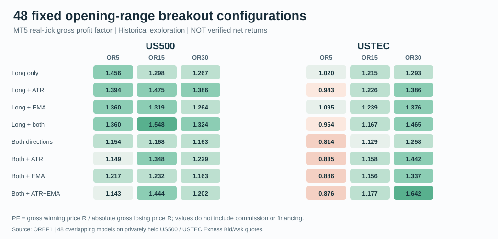
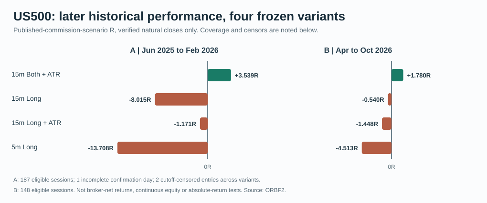

# Opening-range breakout: setup, EMA filter, and out-of-sample results

**Another ORB study | New York cash open | US500 and USTEC CFDs**

[Research library](README.md) · [Full aggregate results](../data/orb-setup-filters-public.json) · [Discovery evidence](../docs/evidence.md#orbf1) · [Later-period evidence](../docs/evidence.md#orbf2)

This is another study in my opening-range breakout research. I tested a cash-open breakout setup with candle-close confirmation, compared range lengths and trade directions, and later added an EMA trend filter. The question was whether these choices improved the discovery results and whether the selected setups held up in later historical data.

## The setup

The reference setup is a **15-minute opening range starting at 09:30 New York time**. After the range forms, a completed 15-minute candle must close outside it, with the previous completed candle's close inside the range. The strategy then enters on the next executable quote. The stop sits at the opposite range boundary and the target is **1.5 times the initial price risk**. The reference direction is long only; the study also tests the corresponding short signal. [ORBF1](../docs/evidence.md#orbf1)

| Component | Tested rule |
| --- | --- |
| Markets | US500 and USTEC index CFD Bid/Ask histories |
| Session clock | 09:30 in America/New_York, following daylight saving time |
| Opening range | Midpoint quote high and low over the first 15 minutes; 5- and 30-minute alternatives are separate variants |
| Long signal | Completed M15 midpoint close above the range high; preceding completed M15 close inside the range, including its boundaries |
| Short signal | Completed M15 midpoint close below the range low, with the same previous-close condition, when both directions are enabled |
| Entry | Next eligible quote after confirmation: buy at Ask or sell at Bid |
| Stop and target | Stop at the opposite opening-range boundary; target at 1.5R from the actual entry |
| Signal window | Last eligible signal candle starts at 11:45 New York and closes at 12:00 |
| Position handling | One currently open position per entry session; a new session may overlap an older session's position |
| Exit management | Stop or target; no scheduled daily exit, breakeven move, or trailing stop |

Confirmation remains on M15 candles for every range length. The first eligible confirmation is **10:00 for both the 5-minute and 15-minute ranges**, and **10:15 for the 30-minute range**. A shorter opening range therefore does not imply an immediate entry when that range ends. Long exits use Bid and short exits use Ask. Freshness, price-grid, stop, and position checks can reject an otherwise qualifying signal. [ORBF1](../docs/evidence.md#orbf1)

### Volatility filter and the later EMA extension

The optional volatility filter requires opening-range width divided by **Wilder ATR(1344)** to lie between **1.25 and 3.0**, inclusive. ATR is measured on completed M15 midpoint bars. Its value is sampled when the bar containing the range end completes: 09:45 for the shorter two ranges and 10:00 for the 30-minute range. This tests whether the range is unusually small or large relative to recent volatility. [ORBF1](../docs/evidence.md#orbf1)

**I later added EMA200 as a trend filter** and compared it on and off across the discovery matrix. A long signal must close above the average and a short signal below it; equality or an unavailable EMA rejects the signal. The EMA uses completed M15 midpoint closes, including the completed signal candle, and is seeded with the first 200 closes. It filters the existing breakout signal rather than creating a new entry by itself. The extension was part of discovery before the later candidate list was frozen. [ORBF1](../docs/evidence.md#orbf1)

## What happened

**The discovery results weakened substantially in the later periods.** All four selected US500 setups had positive average gross R in discovery. The three long-only setups became negative on observed natural closes in both later cohorts. The 15-minute bidirectional setup with ATR stayed slightly positive, but its average gross R per close fell from about **+0.187R** to **+0.063R** and **+0.056R**. All four later-tested US500 setups had **EMA off**. [ORBF1](../docs/evidence.md#orbf1), [ORBF2](../docs/evidence.md#orbf2)

**EMA's later performance remains unknown.** Its discovery comparisons showed tradeoffs in frequency, profit factor, and drawdown, without statistically established improvement in daily returns. The nominated EMA-filtered USTEC setup could not receive a qualified later test because of source-data problems. No EMA-filtered OOS result is claimed. [ORBF1](../docs/evidence.md#orbf1), [ORBF2](../docs/evidence.md#orbf2)

**Decision: no candidate promoted.** The small positive later result was sensitive to additional costs and statistically inconclusive. This finding applies to the tested setups and samples.

## What counts as in sample and out of sample here?

The in-sample/discovery work crossed **2 instruments × 3 range lengths × 2 direction modes × ATR on/off × EMA on/off = 48 configurations**. All received native MT5 real-tick qualification. The matrix was fixed before those comparison results, but the underlying historical sample had already been inspected. It is exploratory, and the eventual shortlist was selected after seeing discovery performance. [ORBF1](../docs/evidence.md#orbf1)

| Sample | Entry-session period | Role and coverage |
| --- | --- | --- |
| US500 discovery | 1 March 2020 through 31 March 2025 | In-sample research and candidate selection |
| USTEC discovery | 1 March 2020 through 28 February 2025 | In-sample research and candidate selection |
| Later cohort A | 1 June 2025 through 28 February 2026 | 187 eligible exchange sessions; one incomplete confirmation day |
| Later cohort B | 1 April through 31 October 2026 | 148 eligible exchange sessions; scored entry windows verified |

Seven candidates were frozen before their later strategy outcomes were opened in **EXP-ORB-011**. Four were US500 setups and three were USTEC setups. The primary choices were US500 OR15 with both directions and ATR, and USTEC OR30 with both directions and no filters. The EMA-on USTEC OR30 alternative was exploratory. Only the US500 candidates completed the later tests. [ORBF2](../docs/evidence.md#orbf2)

Here, **OOS means a later historical evaluation under frozen candidate rules**. These were retrospective tests, not live forward observations. March 2026 was excluded from scored entries because an earlier US500 engineering test had disclosed a trade outcome. USTEC had related cross-strategy exposure in the proposed later periods. The audit did not establish that every later date had been globally unseen in all prior work. [ORBF2](../docs/evidence.md#orbf2)

### How to read the performance numbers

**R** measures outcome relative to a trade's initial risk. **Gross price R** already reflects Bid/Ask spread through the execution sides, but excludes commission and other account charges. Average gross R is total gross R divided by the number of observed natural closes. **Gross profit factor (PF)** is gross winning R divided by the absolute value of gross losing R.

The later commission scenario subtracts a published fee assumption from those outcomes. It is shown separately below. Neither measure establishes historical all-in broker net performance, and the totals from different strategy variants cannot be added as a portfolio return.

## In-sample versus out-of-sample performance

The same four US500 configurations appear in each column. Comparing average R per close is more informative than comparing total R across unequal test lengths. The counts still matter: the later samples contain substantially fewer closes, and Cohort A has incomplete coverage. [ORBF1](../docs/evidence.md#orbf1), [ORBF2](../docs/evidence.md#orbf2)

**Same setup, same gross price-R basis.** Labels show average R per natural close and the number of closes. All plotted setups have EMA off. Cohort A observations do not establish a complete-cohort result. [ORBF1](../docs/evidence.md#orbf1), [ORBF2](../docs/evidence.md#orbf2)

| US500 setup, EMA off | IS closes | IS mean R | A closes | A mean R | B closes | B mean R |
| --- | ---: | ---: | ---: | ---: | ---: | ---: |
| OR15, long only, no ATR | 322 | +0.163 | 65 | -0.110 | 35 | -0.005 |
| OR15, long only, ATR | 211 | +0.245 | 41 | -0.013 | 26 | -0.045 |
| **OR15, long and short, ATR** | **377** | **+0.187** | **74** | **+0.063** | **40** | **+0.056** |
| OR5, long only, no ATR | 240 | +0.238 | 54 | -0.234 | 29 | -0.142 |

Discovery means are calculated from the published gross totals and counts. Later means retain the source report's precision. These are descriptive comparisons between periods, not a formal test of a regime change. [ORBF1](../docs/evidence.md#orbf1), [ORBF2](../docs/evidence.md#orbf2)

| US500 setup, EMA off | IS gross PF | A gross PF | B gross PF |
| --- | ---: | ---: | ---: |
| OR15, long only, no ATR | 1.298 | 0.844 | 0.992 |
| OR15, long only, ATR | 1.475 | 0.980 | 0.928 |
| **OR15, long and short, ATR** | **1.348** | **1.101** | **1.095** |
| OR5, long only, no ATR | 1.456 | 0.670 | 0.785 |

The bidirectional ATR candidate retained more observed performance than the long-only alternatives, but its margin was much smaller. This does not isolate a causal benefit from short selling: allowing another direction also changes which signals can occupy the session's position slot. The full [aggregate dataset](../data/orb-setup-filters-public.json) also reports total R, realized drawdown, and quote-marked drawdown where estimable.

## What did adding EMA change in sample?

These matched examples hold the market, range, direction, and ATR setting fixed while switching EMA200 on. Arrows run **EMA off → EMA on**. Drawdown is realized gross price R over the same discovery period within each pair. [ORBF1](../docs/evidence.md#orbf1)

| Discovery setup | Closes | Gross total R | Gross PF | Realized drawdown R |
| --- | ---: | ---: | ---: | ---: |
| US500 OR15, long, no ATR | 322 → 232 | +52.53 → +40.12 | 1.298 → 1.319 | 16.707 → 12.016 |
| US500 OR15, long, ATR | 211 → 159 | +51.61 → +43.59 | 1.475 → 1.548 | 14.432 → 11.383 |
| US500 OR15, both directions, ATR | 377 → 256 | +70.55 → +59.17 | 1.348 → 1.444 | 23.899 → 15.795 |
| USTEC OR30, both directions, no ATR | 353 → 258 | +50.14 → +46.51 | 1.258 → 1.337 | 16.142 → 13.129 |

In these examples, EMA reduced trade frequency, total gross R, and realized drawdown while increasing PF. They illustrate the tradeoff; they do not represent every configuration. The fixed paired analysis across the full matrix estimated the following EMA effects on the published-commission scenario per common eligible day. [ORBF1](../docs/evidence.md#orbf1)

| EMA-on minus EMA-off daily effect | Mean R/day | Pointwise 95% interval | Holm-adjusted p |
| --- | ---: | --- | ---: |
| US500 | -0.00535 | [-0.01861, +0.00727] | 1.0000 |
| USTEC | +0.00195 | [-0.00604, +0.00966] | 1.0000 |

Both intervals include zero. The study therefore did not establish a reliable daily-return improvement from EMA. Across the full family of **27 main-effect, interaction, and cross-instrument contrasts**, none survived Holm correction; the minimum adjusted p-value was **0.4697**. These tests compare configurations. They do not test every individual strategy's absolute expectancy against zero. [ORBF1](../docs/evidence.md#orbf1)

**The complete discovery surface.** Each cell is one historical configuration's gross PF. Configurations share dates and may share trades, so the 48 cells are not independent replications. The report contains 10,895 overlapping trade observations across them. [ORBF1](../docs/evidence.md#orbf1)

The later US500 tests all used EMA off. The shortlisted **USTEC OR30, both directions, EMA on, ATR off** configuration remains untested on qualified later history. A better-looking discovery PF for an EMA variant is therefore not an established OOS improvement. [ORBF2](../docs/evidence.md#orbf2)

## Later results after the commission assumption

The table reports **published-commission-scenario R on verified natural closes only**. Each cohort was initialized separately. These totals are not a continuous equity curve or a complete daily-return estimate for Cohort A. [ORBF2](../docs/evidence.md#orbf2)

| US500 setup, EMA off | Cohort A | Cohort B |
| --- | ---: | ---: |
| OR15, long only, no ATR | -8.015R | -0.540R |
| OR15, long only, ATR | -1.171R | -1.448R |
| **OR15, long and short, ATR** | **+3.539R** | **+1.780R** |
| OR5, long only, no ATR | -13.708R | -4.513R |

The selected bidirectional ATR setup produced approximately **+5.32R across 114 natural closes**, or **+0.047R per close**, under this commission assumption. Charging an additional hypothetical **0.025R per fill side** reduces the combined closed-trade result to approximately **-0.38R**, before extra financing. At **0.05R per side**, it is approximately **-6.08R**. These are fixed-trade cost sensitivities, not measurements of actual slippage. [ORBF2](../docs/evidence.md#orbf2)

For the fully observed Cohort B, the primary candidate's supplemental estimate was **+0.0120 scenario R per eligible day**, with a **95% block-bootstrap interval of [-0.0573, +0.0870]** and **Holm-adjusted p = 1.0** in the frozen two-primary-hypothesis family. The complete preregistered primary statistic remains unavailable because of the incomplete Cohort A day. The positive closed-trade total does not resolve that missing inference. [ORBF2](../docs/evidence.md#orbf2)

## Limits that affect the interpretation

**Missing observations are not flat trading days.** Discovery retained two missing-source sessions, 1 May 2020 and 3 March 2021, as no-data/no-execution dates. Later Cohort A has incomplete signal-confirmation coverage on **16 October 2025**, so its full-day score is unavailable. Two other A positions, one in each unfiltered long-only variant, remained open at the cutoff and were censored. Across the eight later US500 cells there were **366 entries, 364 natural closes, and two censored entries**. [ORBF1](../docs/evidence.md#orbf1), [ORBF2](../docs/evidence.md#orbf2)

A verified natural close can still come from an incompletely observed day. The natural-close totals above and the complete-day statistical series therefore use different observation sets. Summing only observed complete-day returns need not reproduce the natural-close totals, and missing days are not silently filled with zero.

**USTEC has no qualified later performance result.** Its nominated source history contained a timestamp reversal, three missing cash sessions in Cohort A, eight in Cohort B, and an incomplete final archive. Re-downloading the problematic originals did not restore an admissible stream. The study retained those failures and withheld later USTEC outcomes. [ORBF2](../docs/evidence.md#orbf2)

**Execution and costs remain bounded assumptions.** The native tests used Model 4 real ticks and an isolated **0.10-lot diagnostic contract**. Price-grid rejection materially affected which signals became trades. The commission scenario used published per-lot, per-side fees of **USD 0.125 for US500** and **USD 0.3125 for USTEC**, recorded on 18 November 2026. That schedule is an assumption applied to history, not authenticated historical charges. Quoted spread is already included; additional slippage, financing, dividends, and account applicability remain unverified. Historical all-in net performance is unknown. [ORBF1](../docs/evidence.md#orbf1), [ORBF2](../docs/evidence.md#orbf2)

## Research decision

**No candidate promoted.** The strongest selected US500 setup retained a small positive observed result in later history, but the margin weakened, additional cost debits erased it, and the available inference did not establish positive expectancy. The long-only alternatives deteriorated further. EMA remains a discovery extension with no qualified later result, and USTEC's later test remains blocked.

The next evidence needed is a complete, admissible later sample evaluated under frozen rules and declared execution costs. Tuning the EMA or range settings on the already-opened later results would be a new development exercise and would need a fresh evaluation sample.

## Evidence and reproducibility

The [public aggregate file](../data/orb-setup-filters-public.json) contains all 48 discovery summaries and all eight later US500 rows. The [renderer](../scripts/render_orb_setup_filters.py) rebuilds the three released charts from those aggregates. Repository checks verify the source bindings, arithmetic, missing-value handling, and exact figure bytes. [ORBF1](../docs/evidence.md#orbf1), [ORBF2](../docs/evidence.md#orbf2)

The original review packages were checked for archive integrity and the public values reconciled against their reports. This publication did not rerun the native market experiments. Tick-by-tick histories, full transaction records, and private implementations are required for an independent market replay; public aggregates alone cannot provide one. Detailed source receipts and boundaries are in the [evidence register](../docs/evidence.md#orbf1).

This study sits alongside the separate [ORBINDEX investigation](orbindex.md). Each retains its own setup, samples, and conclusions. Research choices and final decisions were directed by the repository author, with **AI-assisted implementation and test automation**.

*Publication updated 21 November 2026.*
