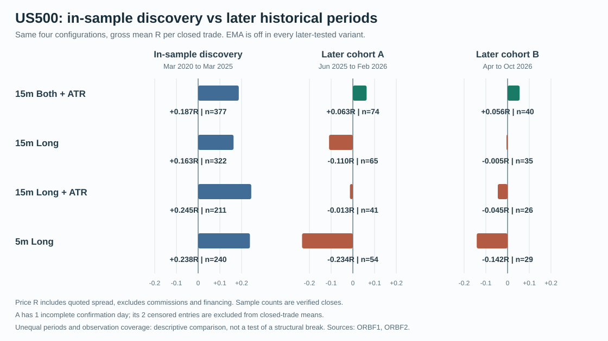

# Opening-range breakout: do the filters hold up in later history?

**Another ORB study | New York cash open | US500 and USTEC CFDs**

[Research library](README.md) · [Technical appendix](orb-setup-filters-appendix.md) · [Aggregate results](../data/orb-setup-filters-public.json) · [Sources](../docs/evidence.md#orbf1)

I tested a cash-open breakout setup, compared range lengths and directions, and later added an exponential moving average (EMA) trend filter. The research question was whether filtering the entries improved performance and whether the selected setups held up in later historical data.

**Finding:** every selected US500 setup weakened in the later periods. The bidirectional setup with a volatility filter retained a small positive observed result, but a hypothetical extra-cost debit erased it. EMA's discovery results were mixed, and no EMA-filtered variant received a qualified later test. **Decision: no candidate promoted.** [ORBF1](../docs/evidence.md#orbf1), [ORBF2](../docs/evidence.md#orbf2)

## The idea and the exact setup

The working hypothesis is that a confirmed move beyond the opening range can capture continuation. A volatility filter based on average true range (ATR) asks whether the opening range is suitably sized relative to recent movement; a trend filter asks whether the breakout agrees with the prevailing direction. These are plausible mechanisms to test, not demonstrated explanations for the results or claims of a novel trading idea.

The reference setup uses a **15-minute range starting at 09:30 New York time**, a completed candle to confirm the breakout, and a **1.5R target**. Here, R measures outcome relative to the trade's initial price risk. [ORBF1](../docs/evidence.md#orbf1)

| Component | Rule |
| --- | --- |
| Range | High and low of midpoint quotes, `(Bid + Ask) / 2`, from the cash open; alternatives use 5 or 30 minutes |
| Confirmation | Completed M15 midpoint close outside the range; preceding completed M15 close inside it, including the boundaries |
| Direction | Long only in the reference; long and short in the bidirectional variant |
| Entry and exit | Next eligible quote: buy at Ask and exit at Bid; sell at Bid and exit at Ask |
| Risk and target | Stop at the opposite range boundary; target 1.5 times initial price risk from actual entry |
| Entry window | First confirmation at 10:00 for OR5/OR15, 10:15 for OR30; last signal candle starts 11:45 and closes 12:00 |
| Positions | One currently open position per entry session; older sessions may overlap; no scheduled daily exit, breakeven, or trailing stop |
| Volatility filter | Optional Wilder ATR(1344) on M15; opening-range width / ATR must be within [1.25, 3.0] |
| Later EMA extension | Optional EMA200 on M15; long signal above the average, short below; equality rejects |

The clock follows New York daylight saving time. Indicators use **all available completed CFD M15 bars**, including outside the cash session. [ORBF1](../docs/evidence.md#orbf1)

**Execution changes the tested strategy.** Raw stop or target prices outside the diagnostic contract's tick grid were rejected, never rounded. For the selected US500 bidirectional ATR setup in discovery, the recorded rejection sequence assigned **715 of 1,890 signals** to this check; **377 became trades**. These results belong to that admission rule. [Exact mechanics and qualification limits](orb-setup-filters-appendix.md#execution-and-native-qualification). [ORBF1](../docs/evidence.md#orbf1)

## The experiment

I compared **2 markets × 3 range lengths × 2 directions × ATR on/off × EMA on/off = 48 configurations**. The matrix was fixed before the comparison outcomes, but the historical sample had already been inspected. This was discovery, not a pristine holdout. I later froze seven candidates, including benchmarks and exploratory alternatives, before opening their later strategy results. [Selection reasons](orb-setup-filters-appendix.md#candidate-selection). [ORBF1](../docs/evidence.md#orbf1), [ORBF2](../docs/evidence.md#orbf2)

| Sample | Entry-session period | Purpose |
| --- | --- | --- |
| US500 discovery | 1 March 2020 through 31 March 2025 | Compare variants and select candidates |
| USTEC discovery | 1 March 2020 through 28 February 2025 | Same discovery design |
| Later cohort A | 1 June 2025 through 28 February 2026 | Frozen evaluation; 187 eligible sessions, incomplete coverage |
| Later cohort B | 1 April through 31 October 2026 | Frozen evaluation; 148 eligible sessions |

Here, **historical OOS** means a later evaluation under frozen rules. These were retrospective tests. March 2026 entries were excluded after an engineering test disclosed a US500 outcome; related prior exposure also existed for USTEC. Globally untouched later history was not established. Only US500 completed qualified later tests. [ORBF2](../docs/evidence.md#orbf2)

## In sample versus later history

The comparison holds each setup fixed and uses **average gross R per natural close**, with trade counts alongside it. Gross price R includes quoted spread through Bid/Ask execution, but excludes commission and other account charges. A natural close reaches the strategy's stop or target; cutoff liquidation is excluded.

| US500 setup, EMA off | IS closes | IS mean R | A closes | A mean R | B closes | B mean R |
| --- | ---: | ---: | ---: | ---: | ---: | ---: |
| OR15, long only, no ATR | 322 | +0.163 | 65 | -0.110 | 35 | -0.005 |
| OR15, long only, ATR | 211 | +0.245 | 41 | -0.013 | 26 | -0.045 |
| **OR15, long and short, ATR** | **377** | **+0.187** | **74** | **+0.063** | **40** | **+0.056** |
| OR5, long only, no ATR | 240 | +0.238 | 54 | -0.234 | 29 | -0.142 |

**All four later-tested setups have EMA off.** Cohort A contains incomplete observations, so these closes do not establish a complete-cohort return. The table is a descriptive comparison, not a formal test of a regime change. [ORBF1](../docs/evidence.md#orbf1), [ORBF2](../docs/evidence.md#orbf2)

The long-only alternatives turned negative in both later cohorts. The bidirectional ATR candidate retained a smaller positive result. This does not isolate a causal benefit from short selling: enabling shorts also changes which signals occupy the session's position slot. [Profit factors, drawdowns, and totals](orb-setup-filters-appendix.md#matched-results).

## What did adding EMA change?

**I later added EMA200 during discovery**, before freezing the later shortlist. To avoid judging it from attractive examples, the summary below includes every matched EMA-off/on pair, holding market, range, direction, and ATR setting fixed. PF is gross winning R divided by the absolute value of gross losing R. [ORBF1](../docs/evidence.md#orbf1)

| Effect of enabling EMA | US500, 12 pairs | USTEC, 12 pairs |
| --- | ---: | ---: |
| PF higher / lower / unchanged at published precision | 5 / 6 / 1 | 11 / 1 / 0 |
| Commission-scenario R per common day higher / lower | 2 / 10 | 6 / 6 |
| Realized gross drawdown lower / higher / unchanged at published precision | 12 / 0 / 0 | 8 / 3 / 1 |
| Fewer trades | 12 | 12 |

Lower drawdown came with reduced participation, so it cannot by itself establish a stronger edge. For example, US500 OR5 long-only without ATR saw PF **fall from 1.456 to 1.360** after adding EMA. [Matched examples and full surface](orb-setup-filters-appendix.md#ema-comparisons). [ORBF1](../docs/evidence.md#orbf1)

The paired daily-return analysis did not establish an EMA improvement. Across the full **27-contrast family**, no main effect, interaction, or cross-market difference survived Holm correction. These comparisons test differences between configurations, not every strategy's absolute expectancy. The shortlisted EMA-on USTEC variant was blocked by source defects, so **EMA's later performance remains unknown**. [ORBF1](../docs/evidence.md#orbf1), [ORBF2](../docs/evidence.md#orbf2)

## Was the remaining positive result convincing?

Under the published-commission assumption, the primary bidirectional ATR setup produced approximately **+5.32R across 114 natural closes**, or **+0.047R per close**, across the two separately initialized later cohorts. A fixed-trade sensitivity shows how little margin remained. [ORBF2](../docs/evidence.md#orbf2)

| Additional hypothetical cost per fill side | Combined observed scenario R |
| --- | ---: |
| None | +5.32 |
| 0.025R | -0.38 |
| 0.05R | -6.08 |

This subtracts two fill-side debits per closed trade. It is not measured slippage, and financing remains extra. The commission schedule is a later published assumption applied to history; historical all-in broker net performance remains unknown. [Cost definition and arithmetic](orb-setup-filters-appendix.md#costs-and-uncertainty). [ORBF2](../docs/evidence.md#orbf2)

For fully observed Cohort B, the supplemental mean was **+0.0120 scenario R/day**, with a **95% block-bootstrap interval of [-0.0573, +0.0870]**. The interval includes meaningful losses and gains. The complete primary statistic remained unavailable because of Cohort A's missing confirmation coverage. A small positive closed-trade total did not resolve that uncertainty. [ORBF2](../docs/evidence.md#orbf2)

## What the evidence supports

**No candidate promoted.** The later observations weakened the discovery case, and the remaining positive margin was sensitive to additional costs. This conclusion applies to these tested setups and samples; it does not establish that every opening-range breakout is ineffective.

Two data limits matter to that decision. Discovery retained missing-source sessions with zero recorded execution contribution in its calendar denominator. Later missing daily outcomes were unavailable, not zero; censored trades were excluded from natural-close results. USTEC received no qualified later result. These policies and their implications are explicit in the [coverage record](orb-setup-filters-appendix.md#coverage-and-missing-observations).

The useful research outcome is a narrower claim: attractive discovery metrics, native execution qualification, and evidence of a tradable edge are separate achievements. I kept the candidate rules frozen and withheld promotion when the later evidence was insufficient. Further work would require complete admissible data and a fresh evaluation sample, rather than tuning on these now-observed results.

## What readers can reproduce

The [released aggregates](../data/orb-setup-filters-public.json) and [renderer](../scripts/render_orb_setup_filters.py) rebuild the charts, paired summaries, and displayed cost arithmetic. They do **not** reproduce the reported bootstrap inference without the private daily series, or the market experiments without private quote, trade, and implementation records. [Reproducibility boundary](orb-setup-filters-appendix.md#evidence-and-reproducibility).

This is a separate study from [ORBINDEX](orbindex.md). I directed the research questions, comparisons, and final decisions; implementation and test automation were **AI-assisted**.

*Presentation revised 23 November 2026; research outcomes unchanged.*
