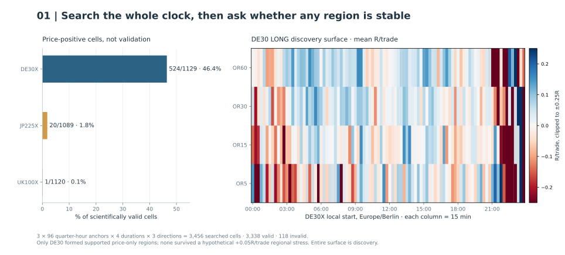
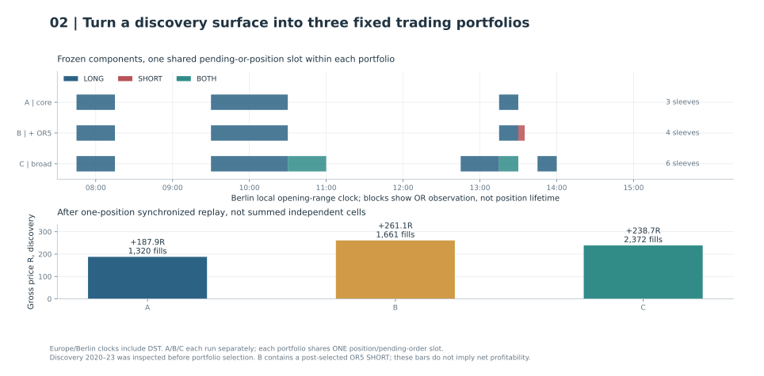
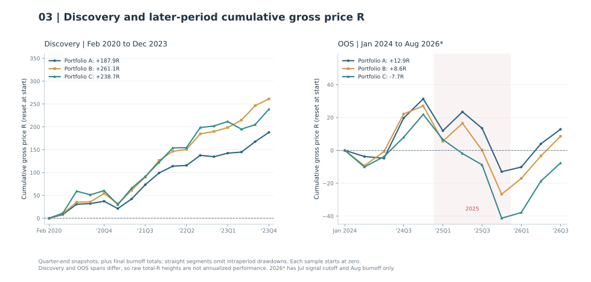
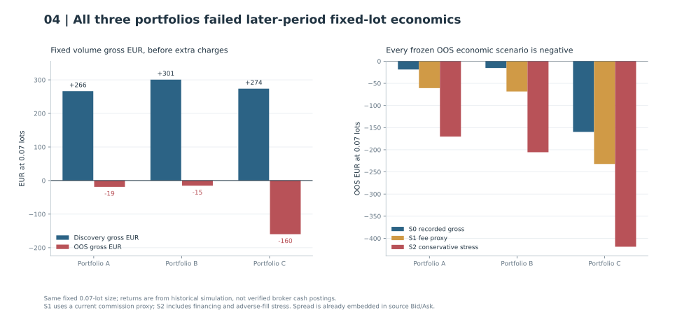
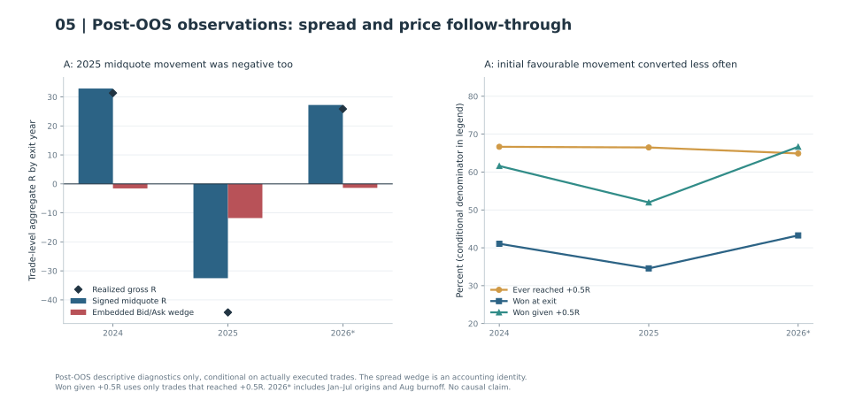

# ORBINDEX: from a 3,456-cell search to an out-of-sample rejection

[Research portfolio](../README.md) · [Evidence and limitations](../docs/evidence.md#ix1) · [Public figure data](../data/orbindex-public.json)

**Research question.** Does a reproducible opening-range breakout (ORB) on major index CFDs survive a broad time-of-day search, shared-order execution, realistic trading-friction scenarios, and a later market period that was not used to choose its configurations?

**Decision: CLOSE / REJECT these three portfolios for economic promotion.** In the later 2024–July 2026 historical period, **all three lost fixed-volume EUR before adding separate commission or financing assumptions**. Some still had slightly positive aggregate risk-normalized R, which is not the same as a profitable fixed-lot strategy. Historical broker-net performance remains unqualified. This is a negative result for the frozen strategies, not a claim that all ORBs are unprofitable. [OOS evidence](../docs/evidence.md#ix3)

The investigation proceeded from hypothesis and data qualification to a full-day timing search, regional screening, synchronized portfolios, execution and economic checks, a frozen later-period comparison, full-quote forensics, and closeout. Each step answers a different question; passing implementation checks alone cannot promote a trading strategy.

## Data universe and experiment identity

The source was **Exness historical Bid/Ask quotes**, imported into a separate **MT5 custom-symbol research environment**. DE30X, JP225X and UK100X represent German, Japanese and UK index CFD research symbols. Local clocks were Europe/Berlin, Asia/Tokyo and Europe/London, respectively, with historical timezone rules. Exchange-session anchor eligibility and observed CFD quotes were kept distinct: a no-quote window does not prove a scheduled broker closure. The discovery used February 2020 through November 2023 signal origins and December 2023 burnoff. [Source and frozen protocol](../docs/evidence.md#ix1)

**EXP-ORBINDEX-001** was the earlier cash-open-centred discovery screen; **EXP-ORBINDEX-002** expanded the local clock under a new frozen design. Both belong to this index investigation. The older gold/US-technology [ORB program](opening-range.md) is a separate experiment lineage; its outcomes are not pooled with ORBINDEX. Original market data, account records and strategy execution code remain private.

## 1. Search the clock, not just the market open

The frozen discovery searched **DE30X, JP225X and UK100X** using 96 quarter-hour local anchors, four opening-range (OR) durations (**5, 15, 30, 60 minutes**) and three independently simulated directions (**LONG, SHORT, BOTH**): **3,456 configurations**. There were **3,338 scientifically valid** cells and **118 invalid** cells. Scientific validity here refers to defined price-path outcomes, not historical broker certification. The invalid cells each contained at least one zero-initial-risk trade, making normalized R undefined; they were retained as terminal invalid states, without capping the denominator or assigning zero returns. All these configurations were evaluated in the already-inspected **February 2020 through November 2023 discovery period**, with December reserved for position burnoff. This was a correlated parameter search, not 3,456 independent experiments. [Discovery protocol](../docs/evidence.md#ix1)

Each eligible day built its range from quoted Bid prices within the fixed opening-range window. The unchanged engine then used a completed five-minute-bar breakout, an entry window limited to two hours after the range, market-versus-retest rules, the **opening-range midpoint stop**, and a target **one range width beyond the broken boundary**. Long entries and short exits used Ask; short entries and long exits used Bid. Trades could remain open overnight, and qualifying signals consumed their sessions. The scientific price-path model and the later physical-session model were kept separate; the latter was checked on bounded MT5 real-tick fixtures, **not** certified as the complete historical broker. [Mechanics and execution qualifications](../docs/evidence.md#ix2)

Positive cells were not promoted individually. The prespecified *descriptive* screen required every cell in a rectangle of **three adjacent quarter-hour anchors × two adjacent OR durations** to be valid and uncensored, contain at least **100 filled trades**, have positive aggregate price R and price profit factor above one, and be positive in at least **three of four originating-signal-year buckets**. Adjacent durations follow the frozen ordered set; anchor triplets do not wrap across midnight. Overlapping passing rectangles form connected display regions under the frozen adjacency rule. DE30X had **10 passing rectangles forming six connected regions at zero extra debit**; **none** survived a hypothetical additional **0.05R per trade** across every member. Japan and the UK yielded no qualifying regions. Their absence is a result for this frozen mechanism, not for the indices in general. [Discovery evidence](../docs/evidence.md#ix1)

[Open Figure 1 at full resolution](../figures/orbindex-search.svg).

**Figure 1.** The right-hand heatmap is deliberately just the **DE30X LONG slice** of the larger searched surface, showing mean price R per filled trade, not a net-profit map. Colour is clipped for legibility and invalid cells are not interpreted as zero-return strategies.

## 2. Combine signals under one account-level execution constraint

Independent single-cell backtests are **not** a portfolio: concurrent signals might compete for the same buying power, a pending order can block another entry, and a trade that remains open overnight changes tomorrow's opportunity set. We therefore built a synchronized, ordered-tick portfolio simulator with **one shared pending-order-or-position slot** per portfolio, deterministic collisions, source Bid/Ask, physical trading-session availability and no forced closure at midnight. Model=4 bounded fixtures checked specified execution paths. These are simulated positions, not broker-deal statements. [Portfolio and parity evidence](../docs/evidence.md#ix2)

Start times below use **Europe/Berlin**, with historical DST handling. `BOTH` is one bidirectional strategy sleeve, not an arithmetic sum of two separate results.

| Portfolio | Frozen local-time sleeves | Role at the later OOS gate |
| --- | --- | --- |
| **A** | 07:45 OR30 LONG; 09:30 OR60 LONG; 13:15 OR15 LONG | Previously nominated primary reference |
| **B** | A plus 13:30 OR5 SHORT | Explicitly **post-selected** OR5 increment |
| **C** | 07:45 OR30 LONG; 09:30 OR60 LONG; 10:30 OR30 BOTH; 12:45 OR30 LONG; 13:15 OR15 BOTH; 13:45 OR15 LONG | Broader timing-region comparison |

[Open Figure 2 at full resolution](../figures/orbindex-portfolios.svg).

**Figure 2.** Blocks show opening-range observation windows, not position holding times. The alternatives are simulated separately; the shared order slot applies within each portfolio.

Their native 2020–2023 discovery runs produced the following fixed-volume gross results. These are synchronized executions, rather than sums of independent cells.

| Portfolio | Trades | Gross price R | Gross EUR at 0.07 lots |
| --- | ---: | ---: | ---: |
| A | 1,320 | +187.94R | +€266.30 |
| B | 1,661 | +261.11R | +€300.59 |
| C | 2,372 | +238.73R | +€273.69 |

B's extra OR5 short made its gross discovery curve look stronger, but that sleeve came from an isolated timing peak without the original neighbouring-duration support. We retained all three configurations unchanged when deciding to inspect later data. [Portfolio evidence](../docs/evidence.md#ix2)

## 3. Open the later period once, and show every result

The later historical evaluation admitted signal origins on **January 1, 2024 through July 31, 2026** (inclusive), with **August 2026 as burnoff only**. All three portfolios ended flat; no exit was fabricated at the cutoff. Two eligible March 2026 dates had no source quotes. The result package reported **36,707,393 source quote observations** over the execution period. [Frozen OOS evidence](../docs/evidence.md#ix3)

[Open Figure 3 at full resolution](../figures/orbindex-curves.svg).

**Figure 3.** Both samples begin at zero and show **quarter-end snapshots plus the final burnoff total** from the native cumulative ledgers. Straight segments between snapshots omit intraperiod fluctuations and cannot measure full closed-trade drawdown. The right-hand chart resets cumulative R at OOS start. It does not splice the apparently smooth discovery path onto a smaller new period or hide the **2025 drawdown**. The discovery and OOS samples have different lengths, so the height of a cumulative line is **not an annualized comparison**.

| Portfolio | Discovery: trades / gross price R | Later period: trades / gross price R | Later gross EUR at 0.07 lots | S1 EUR | S2 EUR | Later max closed DD |
| --- | ---: | ---: | ---: | ---: | ---: | ---: |
| **A** | 1,320 / +187.94R | 962 / +12.87R | **−€18.73** | −€60.81 | −€170.24 | 54.60R |
| **B** | 1,661 / +261.11R | 1,213 / +8.60R | **−€15.34** | −€68.41 | −€205.51 | 63.45R |
| **C** | 2,372 / +238.73R | 1,655 / −7.66R | **−€159.73** | −€232.14 | −€418.89 | 87.16R |

**S0:** gross executable Bid/Ask prices, with spread already included, reference volume 0.07 lots. **S1:** additionally applies a *current* DE30 Raw Spread commission proxy (USD 0.625 per lot round trip, assuming USD 1 = EUR 1) and zero financing. **S2:** a separate conservative hypothetical EUR 2/lot round-trip commission, negative-long financing and extra adverse execution of 0.1 index points per side. These are prespecified **scenarios**, not actual historical account charges, dividend postings or historically certified execution. Historical broker **NET = INDETERMINATE**. [Economic evidence](../docs/evidence.md#ix3)

[Open Figure 4 at full resolution](../figures/orbindex-economics.svg).

**Figure 4.** Both panels use fixed volume and EUR, with zero visible. Discovery and later periods differ in length; their monetary totals are not annualized.

Why can A have **+12.87R but −€18.73**? Each trade's R divides its realised price result by *its own* initial risk distance. Fixed-lot EUR instead weights price movement by contract size and lot volume. Summing unequal-risk R observations is not the same as summing fixed-volume money outcomes. The difference is an economic-accounting issue, not a negative-commission arithmetic bug.

In 2025 alone, A lost **44.32R**, B **53.72R** and C **63.23R**. B's incremental OR5 trades delivered **−4.27R** on the later period. None passed an economic promotion gate under the original scenarios. We did not replace A with B, choose a lucky year cutoff, or tune a filter after viewing these returns.

## 4. Investigate the failure without rescuing the strategy

[Open Figure 5 at full resolution](../figures/orbindex-forensics.svg).

**Figure 5.** A subsequent read-only forensic pass reconstructed **3,830 portfolio-trade records across A/B/C** (including trades shared between alternatives) from their recorded quote paths. For A in 2025, **−44.32R** of realised price outcome decomposed into **−32.53R signed midquote movement** and **11.79R of embedded Bid/Ask spread deduction**. The spread contribution increased, but **price movement remained negative even before that wedge**. A continued losing during late 2025 months when source quotes were predominantly zero-spread. [Post-OOS forensic evidence](../docs/evidence.md#ix4)

The proportion of A trades that *ever* reached +0.5R while open barely changed: **66.7% in 2024 versus 66.5% in 2025**. But among those trades, the share that finished as winners fell from **61.6% to 52.0%**. More breakouts briefly moved favourably before reversing or failing to reach their full target. This is a descriptive observation conditional on accepted trades. It does not establish causality or authorize a new profit-taking rule using spent data.

The DE30X source also showed abrupt historical spread regimes. All original Bid/Ask ticks in the earlier source-integrity audit matched the imported copies; the shifts were upstream of the importer. Neither that integrity check nor the bounded MT5 fixture parity proves the prices were executable under every historically effective broker condition.

## 5. Scientific disposition and why it matters

**Closed, not promoted.** The exact A/B/C portfolios failed to generalize economically under the frozen later-period scenarios. Both source economics and breakout follow-through deteriorated. The initial correlated search and selection restrict what the discovery result can establish. The evidence cannot uniquely attribute the later failure to overfitting, market regime change or broker pricing policy.

The later period is labelled **`OOS_EXPLORATORY / POSSIBLE_PRIOR_EXPOSURE`**, because separate DE30 studies may already have inspected parts of the same historical record. It must not be marketed as a pristine independent holdout. The original weekly bootstrap was also shown uncalibrated under a path-dependent permanent risk halt; **no 95% significance or formal alpha confirmation is claimed here**. That prospective risk halt was not retroactively inserted into these historical OOS replications. The earlier discovery and later 2024–2026 outcome periods are now spent for this lineage. [Limitations](../docs/limitations.md)

The useful outcome is methodological: a wide time search, strict invalid-state accounting, bounded physical parity, synchronized order ownership, fixed economic scenarios, **one frozen later-period comparison**, and an explicit decision to stop. This is a negative experiment worth preserving, not a profitable trading system.

## What is actually reproducible here?

The checked-in [historical aggregate JSON](../data/orbindex-public.json) holds the reviewed cell-level visualization slice, portfolio definitions, quarter-end gross R sequences, economic totals and post-OOS forensic summaries. The [figure renderer](../scripts/render_orbindex.py) regenerates all five SVGs from that file. The public figure tests verify schema, source linkage, XML parsing and data-to-figure response. The public release checks aggregate consistency and presentation. Replaying the private historical backtests requires their protected original sources and execution code. Each figure can be opened at full resolution; the adjacent text and tables retain its main findings for narrow-screen and nonvisual reading.

**Publication verification.** The discovery, synchronized-discovery and frozen-OOS review archives were independently rehashed and CRC-checked for this publication. All search classifications and the displayed heatmap values, native totals and quarterly sequences were cross-checked against their original retained outputs. The original post-OOS forensic archive was unavailable to this publication pass; its summaries and recorded archive hash are reproduced from the hash-verified owner-supplied handoff, without claiming independent source-byte authentication. See [verification scope](../docs/evidence.md#orbindex-publication-verification).

**Research and authorship.** I directed the questions, selected which configurations and portfolios to investigate, approved the fixed OOS A/B/C comparison, and made the closeout decision. Much of the engine implementation, analysis, reporting, testing and drafting used AI assistance. Original ORB trading concepts are not claimed as my invention; exact line-by-line manual authorship is not inferred from Git metadata. See [ownership and attribution](../docs/ownership.md) and the [source register](../docs/evidence.md#ix1).
