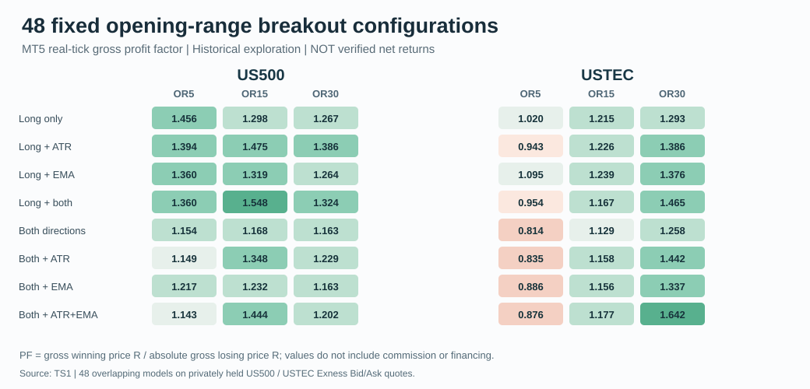
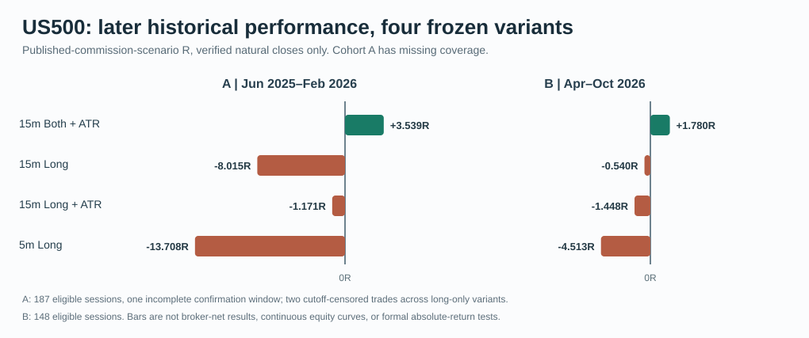

# From a YouTube ORB to a weaker later-period result

**Independent Trading Steady reconstruction | Exness US500 and USTEC CFD research | November 2026**

[Research library](README.md) · [Public 48-cell aggregate data](../data/trading-steady-orb-public.json) · [Source register](../docs/evidence.md#ts1) · [Original creator's ORB explanation](https://www.youtube.com/watch?v=DmNl196oZtQ)

> **Decision: no candidate promoted.** I independently reconstructed the publicly described Trading Steady opening-range breakout (ORB), validated a native MT5 implementation, and investigated 48 fixed variants across two index CFDs. Some historical price-based results were positive, but none of the 27 preregistered **factor or interaction contrasts** remained significant after Holm correction. A post-selected US500 candidate stayed slightly positive on verified natural closes in two later cohorts; its effect was much smaller, cost-sensitive, and not statistically confirmed. The later USTEC evaluation could not be run because its source data failed qualification. This is a bounded research result, not a claim about the creator's private implementation or all ORB strategies. [Evidence TS1, TS2](../docs/evidence.md#ts1)

## 1. Research question

Can an independently reconstructed, simple equity-index ORB retain a positive and stable edge after rule variants are compared systematically and the selected strategies are exposed to later historical market data?

The original idea came from the educational [Trading Steady channel](https://www.youtube.com/@TradingSteady/videos), including its original [S&P 500 breakout overview](https://www.youtube.com/watch?v=DmNl196oZtQ) and [Python automation discussion](https://www.youtube.com/watch?v=z6_3MmqUwRc). The implementation here was reconstructed from publicly described rules and was **not** copied from or verified against the author's proprietary source code. Unverified creator-specific details remain reconstruction assumptions.

This is a **different lineage from [ORBINDEX](orbindex.md)**, which used German, Japanese and UK indices, other entry clocks and different order geometry. Their trade totals and research conclusions must not be pooled.

## 2. What was actually implemented?

The common engine forms an opening range from real chronological midpoint quotes at **09:30 New York time**, with 5-, 15- or 30-minute durations. For every duration, confirmation remains a **completed M15 midpoint candle**: a long requires a close above the opening-range high, a short requires a close below the low, and the preceding completed M15 close must be inside the range. Signals use the **next executable quote**, not a backdated bar-close fill. The last eligible signal candle begins at 11:45 New York. A 5-minute OR with M15 confirmation is not a fast five-minute entry strategy.

Long fills use Ask and exits use Bid; shorts reverse those sides. The stop is the opposite opening-range boundary and the take profit is **1.5 times initial price risk**. There is no scheduled daily liquidation, breakeven adjustment or trailing exit. Positions from different sessions may overlap in the diagnostic hedging model, but within-session signals compete for the same owned position slot.

The independently tested optional filters were Wilder **ATR(1344)**, requiring opening-range width divided by ATR in **[1.25, 3.0]**, and an **EMA(200)** on completed M15 midpoint closes. EMA permits a long only above the average and a short only below it; it does not independently trigger trades. The experiment crossed **2 instruments × 3 OR lengths × 2 direction modes × ATR on/off × EMA on/off = 48 cells**. The original 15-minute, long-only reconstruction is a reference, not a retrospectively invented winning rule. [Evidence TS1](../docs/evidence.md#ts1)

## 3. Discovery: 48 native real-tick comparisons

The discovery/retrospective study covered **March 2020 to March 2025 for US500** and **March 2020 to February 2025 for USTEC**. The original Exness Bid/Ask source had been audited and imported to isolated MT5 custom symbols. **48 of 48** configurations received native Model 4 qualification, with **10,895 trade observations across overlapping variants**. That trade count is **not** 10,895 independent experiments. Two previously qualified US500 runs were reused after identity checks; 46 runs were new. [Evidence TS1](../docs/evidence.md#ts1)

**Figure 1.** Native historical *gross* profit factors for all 48 cases, arranged by market, range and filters. This is a retrospective visualization, not evidence that any particular cell will generalise. [Full numeric source](../data/trading-steady-orb-public.json).

Some representative results:

| Instrument and variant | Closed trades | Gross price R | Gross PF |
| --- | ---: | ---: | ---: |
| US500 OR15, both directions + ATR | 377 | **+70.55R** | 1.348 |
| US500 OR15, long-only + ATR | 211 | +51.61R | 1.475 |
| US500 OR5, long-only, no filters | 240 | +57.24R | 1.456 |
| USTEC OR30, both directions, no filters | 353 | **+50.14R** | 1.258 |
| USTEC OR30, both directions + EMA | 258 | +46.51R | 1.337 |
| USTEC OR5, both directions, no filters | 324 | **−39.99R** | 0.814 |

The market-specific shapes looked interesting: US500 often favoured the 15-minute range, while USTEC's 30-minute variants were stronger than its 5-minute bidirectional variants. But the actual fixed statistical analysis tested **27 main effects and interactions** using paired daily samples, 20-session block bootstraps and Holm familywise correction. **None survived**; the minimum corrected p-value was **0.4697**. These contrasts concern **differences between configurations**. They do **not** directly answer whether each individual strategy has positive absolute expectancy. [Evidence TS1](../docs/evidence.md#ts1)

Native price-grid admission made a substantial difference to which candidate events became trades. Grid rejections are preserved, not silently rounded away. The physical tests used a separately qualified **0.10-lot diagnostic scratch contract**, not proof of the exact historic Exness account, contract or executable volume conditions.

## 4. Freeze candidates, then inspect later history

After the retrospective search, I froze a seven-configuration shortlist in **EXP-ORB-011** before opening its new strategy outcomes. The two nominated **primary** hypotheses were (1) US500 OR15 bidirectional + ATR and (2) USTEC OR30 bidirectional without filters. The other five were reference or exploratory comparisons. The original selection from 48 cells remains explicitly **post-selection**.

The proposed later cohorts were:

| Cohort | Entry-session dates (New York) | Eligible exchange sessions | Status |
| --- | --- | ---: | --- |
| A | June 2025 to February 2026 | 187 | US500 native executed; one incomplete signal-confirmation day |
| B | April to October 2026 | 148 | US500 native executed; complete scored entry windows |
| Both | Same nominated dates for USTEC | 335 scheduled | **USTEC source-blocked** |

March 2026 was kept **out of scored entries** because a March engineering smoke had already disclosed a US500 trade outcome. The source audit also disclosed related prior research exposure in parts of the period. These cohorts are **chronologically later than discovery**, but calling them a globally pristine holdout would overstate independence.

Before any strategy outcomes were released, the US500 audit matched its originally declared source archives to native imported history. The tester initially skipped **332,352 May 2025 warmup ticks**. The retained failed callback check was not erased: an independently reviewed startup method recovered the exact prefix through history replay and verified the indicator/state seam. On that evidence, **all eight US500 cohort × configuration native executions** were reconciled, yielding **366 entries, 364 natural closes and two censored cutoff positions**. The missing-data and censored-state receipts remain part of the research. [Evidence TS2](../docs/evidence.md#ts2)

## 5. The later US500 result

**Figure 2.** Published-commission-scenario R on **verified natural closes only**, for separately initialised cohorts. This is **not** a full daily-return estimate for incomplete Cohort A, a continuous equity curve or historical broker net. [Numeric source](../data/trading-steady-orb-public.json).

| Frozen US500 configuration | Cohort A | Cohort B |
| --- | ---: | ---: |
| **OR15, bidirectional + ATR** (selected primary) | **+3.539R** | **+1.780R** |
| OR15, long-only, no filter | −8.015R | −0.540R |
| OR15, long-only + ATR | −1.171R | −1.448R |
| OR5, long-only, no filter | −13.708R | −4.513R |

The selected primary had **114 verified natural closes** with approximately **+5.32R** under the published-commission scenario across both cohorts, an average of roughly **+0.047R per close**. This compares with approximately **+0.187 gross R per trade** in discovery versus **+0.061 gross R per natural close** in the later cohorts. Those are **different sample sizes, cost bases and observation roles**, so the comparison is descriptive, not a formal structural-break test.

The three long-only configurations were negative in **both** later cohorts. That suggests the selected bidirectional strategy retained more of its measured performance, but does not prove that allowing shorts caused the improvement: direction changes also affect trade competition, selection and occupancy. [Evidence TS2](../docs/evidence.md#ts2)

### How far can the positive result be pushed?

Not very far under simple fixed-ledger stress. The primary's approximately **+5.32R** on closed trades becomes **about −0.38R** if an additional **0.025R per fill side** is charged, before extra financing. At **0.05R per side**, it becomes approximately **−6.08R**. These are hypothetical adverse-execution debits, not measurements of actual live slippage.

Cohort B, the fully observed US500 cohort, yielded an average published-commission-scenario **+0.0120R per eligible day**, with a **95% block-bootstrap interval [−0.0573, +0.0870]** and **Holm-adjusted p = 1.0** under the frozen two-primary-hypothesis family. The interval includes both negative and positive expectancy.

The **full preregistered primary statistic remains unestimable**: October 16, 2025 has incomplete confirmation coverage, so Cohort A cannot be declared fully observed. The two censored entries are in other long-only variants and were not falsely booked as natural exits. No incomplete day was silently converted into a verified zero. [Evidence TS2](../docs/evidence.md#ts2)

## 6. Why USTEC has no later result

The later USTEC source could not be qualified. The original October 2025 file has a backward timestamp transition. There were **three nominated Cohort A cash sessions and eight Cohort B sessions without observed cash quotes**, and the October 2026 archive ended early. Re-downloading tested problematic originals did not restore an admissible stream.

I did **not** silently reorder, splice another vendor, remove unfavourable dates or run on a surviving subset and call that the original test. No later USTEC OOS P&L is claimed. The dual-market conclusion is therefore **inconclusive due to data/execution support**, not a performance failure on USTEC. [Evidence TS2](../docs/evidence.md#ts2)

## 7. What the costs mean

Historical source quotes contain **Bid and Ask**. Their quoted spread is already included in the executable-side simulated entries and exits and is **not subtracted again**. The public primary scenario subtracts the currently published per-side Raw Spread commissions of **USD 0.125 per US500 lot** and **USD 0.3125 per USTEC lot**, converted into initial monetary R under the diagnostic contract. The published fee schedule is a scenario, not verified for the entire history.

Other uncertainties include execution slippage, overnight financing, dividends and administration fees. The scratch metadata and a successful native real-tick tester do not authenticate historic Exness account conditions. Consequently **historical all-in net performance is unknown**, even when a scenario R result is positive.

## 8. Decision and why the negative evidence matters

**Decision: do not promote these reconstructed ORB configurations to live trading.** The retrospective factorial study provided no corrected evidence of a consistently superior parameter choice. The positive later result for the selected US500 bidirectional + ATR version was small, economically fragile under plausible *hypothetical* additional friction, and statistically compatible with negative expectancy. USTEC could not be evaluated on its later nominated data. The formal EXP-ORB-011 decision remains **inconclusive**, not a proven universal ORB failure.

This was a useful research exercise because the implementation was verified independently of its profitability, negative outcomes were retained, and failed data checks were not used as excuses to change an already-frozen strategy. It also illustrates that **a working strategy implementation, a positive historical gross result, a statistically demonstrated filter advantage and a deployable net edge are four different claims**.

## 9. Research chronology and reproducibility

| Research phase | What changed | Interpretation |
| --- | --- | --- |
| v001 | Independent reference recreation and tests | Publicly described rules, not proprietary code parity |
| v002–v005 | Native transactions, chronology and first US500 real-tick trade | Engineering correctness, not profitability |
| v006–v007 | Roughly five years of native US500 gross replication | Positive bounded discovery; historic costs unverified |
| v008 | 48-cell dual-market factorial | None of 27 corrected factor contrasts significant |
| v009–v010 | Unactivated future-feed/shadow research preparation | Not part of this historical OOS evidence |
| v011 | Frozen seven-candidate study; eight US500 later native cells | Weak later US500 results, incomplete full inference; USTEC source blocked |

**Publicly reproducible:** all 48 transcribed summary cells and the eight later US500 comparison rows are in [the public aggregate file](../data/trading-steady-orb-public.json). The released figures rebuild from these aggregates. Their arithmetic and disclosed evidence hashes can be inspected independently.

**Not publicly reproducible from this repository:** the vendor tick-by-tick histories, private native EA, actual MT5 transaction ledgers and full broker accounts. Independent market replay requires access to the original source histories and declared executable-contract assumptions. The private research evidence was checked for source/archive integrity, but public summary values are not a substitute for the full event tapes.

Source receipts are indexed at [TS1 (factorial)](../docs/evidence.md#ts1) and [TS2 (later US500 study)](../docs/evidence.md#ts2). Research design, experiments and final decisions were directed by the repository author with **AI-assisted implementation and test automation**. Trading Steady is credited as the source of the publicly explained hypothesis, not an endorser of these experiments.

---

*Research publication as of 21 November 2026. The earlier [ORBINDEX investigation](orbindex.md) is separately reported and must not be conflated with this independent reconstruction.*
